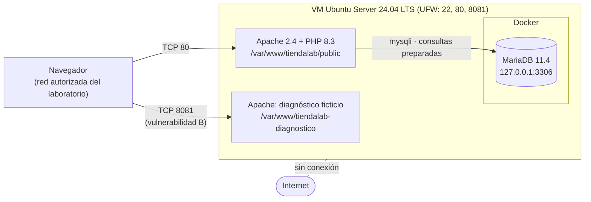
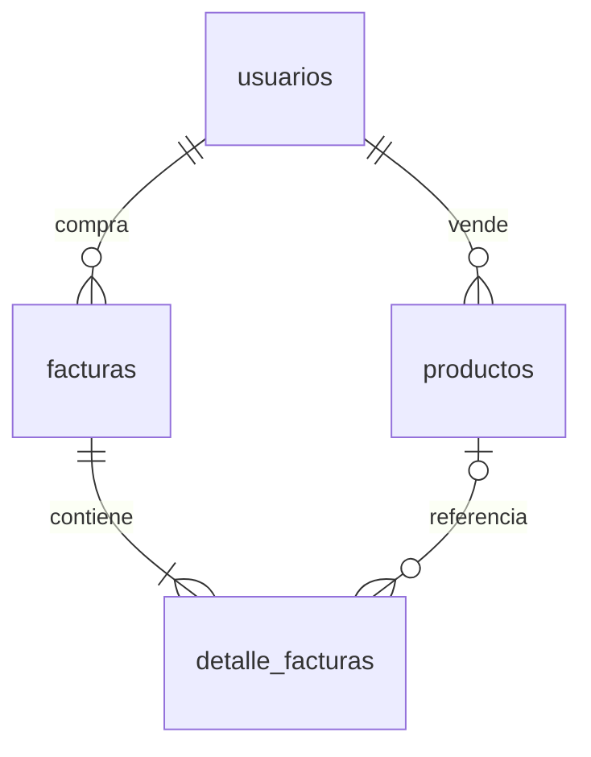

# TiendaLab

Tienda en línea sencilla con tres roles (comprador, vendedor y administrador), hecha con **PHP puro, HTML/CSS/JavaScript nativo y MariaDB con mysqli**, sin frameworks, ORM ni servicios en la nube. Es un proyecto de la materia *Seguridad en Entornos de Desarrollo* (UCA): se despliega en una máquina virtual **Ubuntu Server 24.04 LTS** y deja **exactamente dos vulnerabilidades deliberadas y documentadas** para la práctica de pentesting en el laboratorio.

> **Uso exclusivamente académico.** Todos los datos y cuentas son ficticios. La VM solo debe conectarse a la red autorizada del laboratorio y **nunca** exponerse a internet ni abrirse puertos en el router.

**Integrantes:** Samuel Rodríguez (00016420), Alejandro Vasquez (00081320), Evan Cruz (00076523). Repositorio: <https://github.com/Vasquezzz247/TiendaLab-SED>.

---

## 1. Descripción del proyecto y roles

| Vista | Acceso | Qué se puede hacer |
| --- | --- | --- |
| Index (`/`) | Pública | Ver el catálogo real de MariaDB y buscar productos |
| Login (`/login.php`) | Pública | Iniciar sesión con correo y contraseña; cada rol va a su página |
| Registro (`/register.php`) | Pública | Crear una cuenta; **siempre queda como comprador** |
| Comprador | Con sesión | Elegir cantidades, carrito (modificar/quitar), subtotal + IVA 13 % + total, confirmar la compra, ver y imprimir sus facturas |
| Vendedor | Con sesión | Publicar y editar **sus** productos (nombre, descripción, precio, existencias, imagen) |
| Administrador | Con sesión | Métricas, CRUD completo de productos y de usuarios, cambio de roles, activar/desactivar usuarios |

Cada vista revisa en el servidor la sesión y el rol; no se confía en nada que envíe el navegador. La compra es una **transacción SQL**: verifica existencias y precios en la base, descuenta el stock, crea la factura y su detalle, y confirma todo o revierte todo.

## 2. Arquitectura

### Tecnologías

| Parte | Tecnología | Por qué |
| --- | --- | --- |
| Sistema | Ubuntu Server 24.04 LTS en una VM (VirtualBox) | Es el servidor Linux que pide el proyecto |
| Servidor web | Apache 2.4 instalado en Ubuntu (puertos 80 y 8081) | Corre la tienda y el servicio de diagnóstico |
| Backend / frontend | PHP 8.3 puro (mod_php), HTML, CSS y JavaScript nativo | Sin framework, para entender y explicar todo el código |
| Base de datos | MariaDB 11.4 en un contenedor Docker (solo `127.0.0.1:3306`), acceso con `mysqli` y consultas preparadas | Aislada y reproducible, sin ORM |
| Versiones | GitHub con GitFlow | Historial ordenado por ramas y Pull Requests |

No se contenerizó la aplicación: solo MariaDB va en Docker.

### Diagrama de arquitectura



| Puerto | Servicio | Alcance |
| --- | --- | --- |
| TCP/80 | Tienda | Red del laboratorio |
| TCP/8081 | Diagnóstico de laboratorio (**vulnerabilidad B**, ficticio) | Red del laboratorio, a propósito |
| TCP/3306 | MariaDB | Solo `127.0.0.1` dentro de la VM |
| TCP/22 | SSH (administración) | Red del laboratorio |

### Base de datos



Cuatro tablas InnoDB con claves foráneas activas (`database/init/01-schema.sql`): `usuarios` (rol ENUM, correo único, `password_hash`, `activo`), `productos` (precio > 0, stock ≥ 0, imagen, dueño `vendedor_id`), `facturas` (subtotal; IVA 13 % y total son columnas generadas) y `detalle_facturas` (conserva nombre y precio históricos). Un usuario con facturas o productos no se borra físicamente: se **desactiva**; un producto eliminado deja `producto_id` en NULL pero conserva su historia. Usuario SQL de la aplicación (`tiendalab_app`): solo SELECT/INSERT/UPDATE/DELETE sobre `tiendalab.*`. Detalles en [docs/BASE_DE_DATOS.md](docs/BASE_DE_DATOS.md).

### Estructura de carpetas

```text
public/                 Única raíz web de Apache (rutas reales y assets)
app/                    Lógica PHP: web.php (rutas y roles), auth.php (sesiones, CSRF, límites),
                        database.php (mysqli), shop.php (carrito, compras, facturas),
                        management.php (productos y usuarios), images.php, views/live/ (vistas)
database/init/          Esquema, datos ficticios y privilegios del usuario SQL
diagnostico/            Página estática del servicio de diagnóstico ficticio (puerto 8081)
deploy/                 Configuración de Apache y PHP para Ubuntu
scripts/ubuntu/         instalar.sh, verificar.sh, comprobar-red.sh, preparar-offline.sh
scripts/vm/             crear-vm.ps1 (VM de VirtualBox)
scripts/                exportar.ps1, auditar-*.py, verificar-*.ps1 (pruebas)
tests/                  Pruebas HTTP/BD, PHP y JavaScript
compose.yaml            Solo MariaDB: imagen fijada por digest, salud, puerto local y volumen
docs/, REPORTES/        Guías, matriz de requisitos, reportes por fase y evidencias reales
app/views/, demo/, public/prototipo/   Maquetas históricas de la fase 1, apagadas por defecto
storage/ (no versionada) Sesiones, límites e imágenes subidas; fuera de public/
```

### Seguridad implementada (controles normales)

Contraseñas con `password_hash`/`password_verify`; ID de sesión regenerado al autenticar, cookies HttpOnly/SameSite, caducidad por 30 min de inactividad u 8 h, rol y estado consultados en la base en cada petición; token CSRF en todo POST; consultas SQL preparadas; escape de salida HTML; validación de entradas en el servidor; límite de intentos de login (5 fallos por correo y 60 por IP en 15 minutos; solo cuentan los fallos); imágenes JPG/PNG/WEBP de hasta 2 MB que se re-codifican a PNG y se guardan fuera de `public/`; errores controlados sin información interna; `.env` con permisos 640 y secretos aleatorios; cabeceras `nosniff` y política de contenido. La explicación sencilla de cada control está en [docs/GUIA_SEGURIDAD_Y_DEFENSA.md](docs/GUIA_SEGURIDAD_Y_DEFENSA.md).

---

## 3. Instalación paso a paso (desde la creación de la VM)

Guía ampliada, tiempos y riesgos: [docs/INSTALACION_UBUNTU.md](docs/INSTALACION_UBUNTU.md). Los pasos 2 a 5 se **ejecutaron de verdad** en una VM de VirtualBox con Ubuntu 24.04.5 (resultados en `REPORTES/evidencias/fase05-*.txt` y `fase06-*.txt`). El paso 1 (crear la VM con el script) se probó **solo en parte**: el script crea la VM sin errores, pero un ensayo completo desde cero con la versión final no pudo terminar porque el instalador de Ubuntu se bloqueó dentro de VirtualBox (ver sección 9). Si eso pasa, usa la alternativa manual.

**Qué llevar (kit sin internet):** el ISO `ubuntu-24.04.5-live-server-amd64.iso` (SHA-256 oficial `97f3d7ffb032c3eb3b23d2c8be9cc76e60c2c1f2c0146ba5ba9fe01cafae0fd8`), el ZIP limpio del proyecto y la carpeta `offline/` (29 paquetes `.deb` y `tiendalab-mariadb.tar`). `scripts/exportar.ps1` genera el ZIP; ver [docs/INSTALACION_UBUNTU.md](docs/INSTALACION_UBUNTU.md) para armar `offline/`.

1. **Crear la máquina virtual** (Windows con VirtualBox 7):

   ```powershell
   .\scripts\vm\crear-vm.ps1 -Iso C:\ruta\ubuntu-24.04.5-live-server-amd64.iso -IsoSha256 97f3d7ffb032c3eb3b23d2c8be9cc76e60c2c1f2c0146ba5ba9fe01cafae0fd8
   ```

   Crea la VM (2 CPU, 3 GB de RAM, 30 GB), red NAT con reenvíos solo a `127.0.0.1` (SSH 2222, tienda 8080, diagnóstico 18081) e instala Ubuntu sola con SSH por clave. Alternativa manual: instalar Ubuntu Server 24.04 marcando «OpenSSH server» con el usuario `tiendalab`.
2. **Copiar el proyecto y el kit** a `~/TiendaLab-SED` en la VM (`scp` con la clave generada, o `git clone https://github.com/Vasquezzz247/TiendaLab-SED.git`).
3. **Instalar con un solo comando** dentro de la VM:

   ```sh
   cd ~/TiendaLab-SED && sudo bash scripts/ubuntu/instalar.sh
   ```

   Instala Apache y PHP 8.3, Docker y UFW; despliega la tienda con `public/` como raíz; crea el `.env` con secretos aleatorios; levanta MariaDB en Docker solo en loopback con el seed ficticio; publica el diagnóstico del 8081; y ejecuta la verificación. Con la carpeta `offline/` no usa internet. Se puede repetir sin perder datos.
4. **Verificar:** `sudo bash scripts/ubuntu/verificar.sh` (34 comprobaciones) y `sudo bash scripts/ubuntu/comprobar-red.sh`.
5. **Usar:** <http://127.0.0.1:8080/> desde el anfitrión (o `http://<IP de la VM>/` desde otro equipo de la red).

**Tiempos medidos** (VM de VirtualBox, 2 CPU): `instalar.sh` sin internet **4 min 54 s** (3 min 39 s al repetirlo); instalar el sistema Ubuntu con `crear-vm.ps1` tardó **unos 25 min** porque el instalador descarga actualizaciones por una red lenta. El total puede acercarse a los 30 minutos: ver los riesgos en la sección 9.

**Desarrollo local en Windows:** `php scripts/preparar-entorno.php` (crea `.env`), `docker compose up -d --wait`, `.\scripts\iniciar-frontend.ps1` y <http://127.0.0.1:8000/>. Requiere PHP 8.3 con mysqli, mbstring, fileinfo y gd.

## 4. Usuarios y credenciales de prueba

Contraseña de demostración, pública y ficticia, para las cinco cuentas: `TiendaLab-Demo-2026!` (no sirve para administrar MariaDB).

| Correo | Rol |
| --- | --- |
| `admin@tiendalab.test` | Administrador |
| `vendedor@tiendalab.test` | Vendedor |
| `ana@tiendalab.test` | Comprador (facturas 1, 3 y 4) |
| `luis@tiendalab.test` | Comprador (factura 2) |
| `carla@tiendalab.test` | Comprador |

El registro público siempre crea compradores. Las claves SQL del `.env` se generan al azar en cada instalación y no están en el repositorio.

## 5. Vulnerabilidades implementadas

Exactamente dos, acotadas, con datos inventados y documentadas con su reproducción, impacto y mitigación (secciones 20 y 21 de [docs/GUIA_SEGURIDAD_Y_DEFENSA.md](docs/GUIA_SEGURIDAD_Y_DEFENSA.md)). No se desactivó ninguna protección global para introducirlas.

### A. IDOR en `factura.php?id=` (nivel de código)

- **Dónde:** `invoice_detail()` en `app/shop.php` (marcada `VULNERABILIDAD A`), llamada desde `app/web.php`.
- **Cómo se introdujo:** la consulta individual de facturas **no comprueba que la factura pertenezca al comprador autenticado** (se quitó el `AND comprador_id=?`). Siguen intactos la sesión, el rol comprador, el historial por usuario, la validación del `id` como entero y la consulta preparada, así que **no es una inyección SQL**.
- **Reproducción:** iniciar sesión como `ana@tiendalab.test`, abrir `/historial.php` (ve las facturas 4, 3 y 1) y cambiar la URL a `/factura.php?id=2`: aparece la factura de Luis. Evidencia real: `REPORTES/evidencias/fase04-idor-reproduccion.txt`.
- **Impacto:** exposición del nombre, correo y compras de otro cliente (datos ficticios aquí).
- **Mitigación:** volver a `WHERE f.id=? AND f.comprador_id=?` con el usuario de la sesión; opcionalmente usar identificadores no secuenciales.

### B. Servicio de diagnóstico expuesto en TCP/8081 (nivel de servidor)

- **Dónde:** `diagnostico/index.html` (página estática) y `deploy/apache/tiendalab-diagnostico.conf` (marcada `VULNERABILIDAD B`).
- **Cómo se introdujo:** un sitio de Apache independiente de la tienda, **sin enlace desde ella**, que escucha en todas las interfaces y no restringe por IP. Muestra información interna **inventada** (hostname, usuario y clave ficticios, rutas). No ejecuta PHP ni comandos, no lista directorios y solo acepta GET/HEAD/OPTIONS.
- **Reproducción:** desde otro equipo autorizado, `nmap -p 80,8081,3306 <IP de la VM>` muestra el 80 y el 8081 abiertos y el 3306 no; abrir `http://<IP de la VM>:8081/` muestra el panel. (En las pruebas se comprobó dentro de la VM y por el reenvío local; ver los límites en la sección 9.)
- **Impacto:** divulgación de información interna (inventada).
- **Mitigación:** `sudo a2dissite tiendalab-diagnostico` y `sudo ufw deny 8081`, o restringir con `Require ip 127.0.0.1`.

## 6. Flujo de trabajo en GitHub (GitFlow)

Ramas permanentes `main` (entrega) y `develop` (integración); ramas de apoyo `feature/*` por módulo (login, catálogo, facturas, vulnerabilidades, despliegue), `release/*` y `hotfix/*`. Cada cambio entra por **Pull Request** con merge commit (sin force push, rebase ni squash), y las pruebas se ejecutan antes de fusionar. Hay 16 Pull Requests reales hacia `develop` (fases 0 a 7, correcciones de auditoría y despliegue) y la `release/1.0.0` hacia `main`; la versión entregada lleva la etiqueta `v1.0.0` y su resumen está en [CHANGELOG.md](CHANGELOG.md). Detalle, SHA y procedimiento: [docs/GITFLOW.md](docs/GITFLOW.md).

## 7. Pruebas reproducibles

| Qué | Comando | Resultado registrado |
| --- | --- | --- |
| Suite HTTP/BD (120 comprobaciones), PHP y JS, en Windows | `.\scripts\verificar-backend.ps1` | 120/120, 8 PHP, 3 JS |
| La misma suite contra la tienda instalada en Ubuntu | `.\scripts\verificar-ubuntu.ps1` | 120/120 |
| Base de datos (24 comprobaciones) | `.\scripts\verificar-base.ps1` | 24/24 (base sin compras) |
| Servicio de diagnóstico (Apache real en contenedor) | `.\scripts\verificar-diagnostico.ps1` | 24/24 |
| Instalación en la VM | `sudo bash scripts/ubuntu/verificar.sh` | 34/34 |

Cada suite crea datos ficticios aislados, prueba contra MariaDB real y comprueba el SHA-256 del seed al limpiar.

## 8. Documentación

[Guía de seguridad y defensa](docs/GUIA_SEGURIDAD_Y_DEFENSA.md) · [Instalación en Ubuntu](docs/INSTALACION_UBUNTU.md) · [Base de datos](docs/BASE_DE_DATOS.md) · [Matriz de requisitos](docs/MATRIZ_REQUISITOS.md) · [Alcance](docs/ALCANCE.md) · [GitFlow](docs/GITFLOW.md) · reportes por fase en [REPORTES/](REPORTES/) (`FASE_00` a `FASE_07`).

## 9. Límites y pendientes (sin maquillar)

- **Ensayo completo desde cero no completado:** al repetir la creación de la VM con la versión final de `crear-vm.ps1`, la instalación de Ubuntu se bloqueó (avisos de kernel dentro del instalador; había otra VM encendida en el mismo equipo) y se canceló. Lo validado es: la creación de la VM (16 s), la instalación de Ubuntu con una versión anterior del script, y los pasos 2 a 5 sobre esa VM. Antes de la entrega conviene repetir el ensayo con **una sola VM encendida**.
- La prueba de puertos se hizo **desde dentro de la VM**, no desde otro equipo real de la red del laboratorio.
- **Riesgo de los 30 minutos:** instalar Ubuntu consumió unos 25 minutos en la red de pruebas; el instalador del proyecto, unos 5. Conviene confirmar con el docente cómo se cuenta el tiempo y llevar el kit sin internet completo.
- No se generó un PDF de factura (solo se verificó que existe CSS de impresión); HTTPS no está configurado; en móvil algunas tablas se desplazan horizontalmente.
- Las pruebas de seguridad son las del propio proyecto, no una prueba de penetración independiente; la auditoría estática es por patrones.
- El repositorio es público (por autorización previa) y conserva los PDF originales, que contienen nombres y carnets académicos. `.env`, sesiones, imágenes subidas, herramientas y temporales no se publican.
- Las maquetas históricas de la fase 1 (`public/prototipo/`, `app/views/`, `demo/`) siguen en el repositorio pero están apagadas y bloqueadas en Apache.
