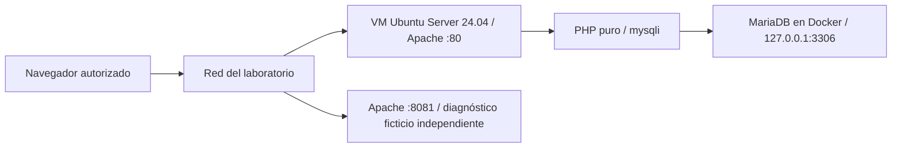

# TiendaLab: alcance aprobado

Fecha de análisis: 18 de noviembre de 2026. Fuentes completas: `DefinicióndelProyecto(1).pdf` (6 páginas) y `Propuesta_TiendaLab.pdf` (11 páginas físicas: 5 de propuesta y 6 de anexo). Los números de página de este análisis son físicos. Se leyó el texto y se inspeccionaron las 17 páginas renderizadas, incluidas tablas y diagrama.

## Prioridad y autorización

La definición del docente es obligatoria; la propuesta concreta el alcance. El usuario declara aprobada la propuesta. No se dispone de un documento adicional que certifique esa aprobación. El prompt adjunto autoriza expresamente **fases 0 y 1** en esta ejecución; esta autorización conjunta permite ejecutar ambas y obliga a detenerse antes de fase 2. Cada fase conserva su reporte independiente.

## Producto y arquitectura final

Tienda de tecnología con catálogo público, login, registro de compradores, carrito, facturas, vendedor y administración. PHP puro, HTML5, CSS3, JavaScript nativo y mysqli. Apache y PHP se ejecutarán sobre Ubuntu Server 24.04 LTS en VM; solamente MariaDB estará en Docker, administrada mediante Compose y volumen persistente.



No nube, CDN, APIs externas, frameworks, ORM, CMS, BaaS ni proyectos vulnerables preconstruidos. No se publica mediante Sites: su hosting en nube sería incompatible. No se crean pagos, envíos, cupones ni módulos comerciales adicionales.

## Requisitos funcionales

- Público: catálogo con nombre, descripción, imagen, precio y existencias; buscador; enlaces a login y registro. Comprar requiere sesión en el producto final.
- Login: correo y contraseña; redirección por rol; cierre de sesión real en fase 3.
- Registro: nombre, correo, contraseña y confirmación; rol comprador asignado en servidor.
- Comprador: catálogo, cantidades enteras positivas limitadas por stock, agregar y quitar, carrito, subtotal, IVA 13 %, total, confirmación, descuento de stock, factura detallada e historial propio.
- Vendedor: alta con nombre, descripción, precio, existencias e imagen; listado y edición de sus productos.
- Administrador: resumen, CRUD completo de productos y usuarios y cambios de rol. El CRUD de usuarios incluye edición de nombre y correo aunque la captura destaque el cambio de rol.
- Diagnóstico: página separada, solo datos ficticios, sin enlaces desde la tienda; no se implementa ni se abre 8081 en esta entrega.

## Seguridad planificada

Todas las vistas restringidas requerirán sesión y autorización en servidor. Contraseñas con hash de PHP, consultas mysqli parametrizadas, escape de salida, protección de cambios contra CSRF, validación de imágenes, límites de intentos y sesiones seguras. La única omisión futura será verificar la propiedad en `factura.php?id=` **después** de autenticar al usuario. La redacción ambigua de propuesta p. 2 no permite eliminar la autenticación, obligatoria en definición p. 1.

Exactamente dos vulnerabilidades deliberadas en fase 4: IDOR de facturas ficticias y diagnóstico HTTP 8081 visible únicamente en red autorizada. No se implementan todavía. El diagnóstico del anexo muestra una clave ficticia: jamás se sustituirá por una clave de servicio real ni se conectará a administración del sistema. No se garantiza ausencia absoluta de fallos; se verificarán los controles en fase 6.

## Alcance de fase 1 y separación del prototipo

Las páginas públicas serán plantillas PHP. Las vistas de roles estarán aisladas bajo `/prototipo/`, con rótulo permanente de demostración. No son rutas finales ni una sesión simulada. Se habilitan únicamente con `TIENDALAB_PROTOTIPO=1` y acceso loopback; de otro modo responden 404. No se crean las rutas finales de comprador, vendedor, admin o factura.

Los datos ficticios viven en `demo/`, separados de `app/views/` y `app/components/`. El carrito visual conserva únicamente selecciones de demostración en sessionStorage de la pestaña, se puede reiniciar y nunca confirma compras. Los formularios permiten revisar validación y previsualizar imágenes, pero no envían credenciales, publican productos, crean usuarios, cambian roles ni borran datos. No se muestran mensajes de éxito de operaciones inexistentes. Las facturas son ejemplos previamente definidos, nunca generadas por una compra simulada.

## Lectura visual completa del anexo

| Página / captura | Hallazgos de diseño y flujo | Aplicación en fase 1 |
| --- | --- | --- |
| 6 / 1 | Marca T con gradiente, encabezado blanco, catálogo/login/registro. Hero morado a turquesa; buscador; 9 productos; tarjetas de cuatro columnas con iniciales sobre gradientes. | Catálogo y hero; imágenes SVG locales con iniciales, mismas familias cromáticas. |
| 6 / 2 | Login dividido: bienvenida morada, beneficios a izquierda y formulario a derecha; pie discreto. | Componente de acceso dividido reutilizado en registro. |
| 7 / 3 | Registro con nombre, correo, contraseña y confirmación; comprador automático. | Validación visual; sin selector de rol ni alta real. |
| 7 / 4 | Comprador Ana Martínez; catálogo, facturas, contador de carrito; controles - / cantidad / + y Agregar. | Vista aislada con cantidades, contador y carrito de demostración. |
| 8 / 5 | Carrito con audífonos 39.99 y cámara 34.00; subtotal 73.99, IVA 9.62, total 83.61; botón confirmar. | Cálculo en centavos y confirmación bloqueada con explicación. |
| 8 / 6 | Factura centrada, marca, comprador, fecha, líneas, desglose e imprimir/PDF; sin validez fiscal. | Documento de ejemplo imprimible con marca de demostración. Sin aviso de compra realizada. |
| 9 / 7 | Historial tabular con número, fecha, productos, total, Ver factura. | Ejemplos de Ana y enlaces a sus detalles. |
| 9 / 8 | Ana accede a factura de Luis modificando id. | Solo se analiza; NO se reproduce la vulnerabilidad en fase 1. |
| 10 / 9 | Vendedor: formulario a izquierda, tabla a derecha, imagen JPG/PNG/WEBP hasta 2 MB, editar. | Formulario reutilizable, tabla y edición de borrador visual. |
| 10 / 10 | Administración: cuatro métricas, pestañas productos/usuarios, nuevo/editar/eliminar. | Resumen ficticio consistente, tablas y formularios; sin cambios persistentes. |
| 11 / 11 | Usuarios: lista a izquierda y formulario a derecha; selector de roles. | Alta y edición visual completas; cambio de rol señalado como borrador. |
| 11 / 12 | Diagnóstico oscuro monoespaciado, servidor, BD y rutas. | Reservado para fase 4, fuera del frontend autorizado. |

Las capturas corresponden a distintos momentos: stock 25/24 y cámara 15/14, y el resumen de ventas no coincide exactamente con las facturas visibles. Se conservará el diseño y se usarán ejemplos internamente consistentes, sin afirmar que sean una base de datos extraída del PDF. Se mantiene la factura de referencia 73.99 + 9.62 = 83.61.

## Estructura sencilla

```text
public/                 DocumentRoot, páginas públicas y assets locales
  prototipo/            Vistas visuales habilitadas solo para revisión local
app/components/         Cabecera, pie, tarjetas y formularios
app/views/              Plantillas por pantalla
demo/                   Datos ficticios separados; sin credenciales
scripts/                Inicio y comprobación de frontend
tests/                  Comprobaciones de frontend sin dependencias
docs/                   Alcance, matriz y guía de revisión
REPORTES/               Reporte y evidencia de cada fase
tmp/                    Renderizados y temporales ignorados
tools/php/              Intérprete portátil local ignorado, si disponible
```

En fases posteriores se añadirán base SQL/Compose, configuración Ubuntu/Apache y diagnóstico independiente. No se generan implementaciones vacías que aparenten completar esas fases.

## Entrega, pendientes externos y diferencias

- La definición pide al menos una vulnerabilidad de cada tipo; la propuesta concreta exactamente las dos descritas. Son compatibles.
- PHP sin framework y mysqli están expresamente permitidos; ningún requisito exige una tecnología incompatible.
- El servidor integrado de PHP se usa solo para vista previa local en Windows; Apache sigue siendo el destino final.
- Entrega: 27/11/2026, Laboratorio 4, máximo 30 minutos. Pruebas autorizadas: 30/11 y 01/12/2026. No se ha cronometrado una instalación real.
- Quedan por confirmar con el docente modo de conexión de la VM y si puede llevarse preconfigurada (propuesta p. 4). No bloquea el frontend.
- GitHub remoto, PR, credenciales ficticias por rol, scripts Ubuntu, alternativa offline, pruebas reales de red, auditoría de seguridad y playbook se completarán en sus fases. El playbook depende de hallazgos reales en objetivos autorizados: no se fabrican evidencias.
