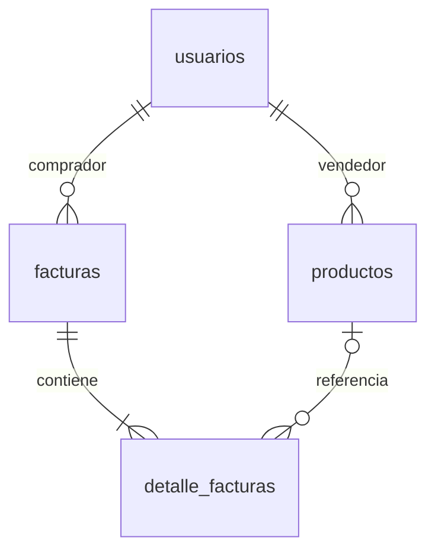

# Base de datos de TiendaLab — fases 2 y 3

Solo MariaDB está en Docker. PHP y Apache serán servicios del host Ubuntu. Las pruebas actuales se ejecutaron desde PHP CLI en Windows hacia MariaDB en Docker Desktop; no equivalen a un despliegue Ubuntu.

## Modelo



`database/init/01-schema.sql` crea cuatro tablas InnoDB y cuatro claves foráneas. IDs enteros autoincrementales; correo único; rol ENUM con comprador por defecto; precio/stock/cantidad restringidos. `activo` permite retirar usuarios/productos sin romper referencias históricas. Borrar físicamente un usuario referenciado se rechaza; borrar un producto conserva nombre y precio históricos en el detalle y deja producto_id NULL. Borrar una factura con líneas se rechaza. El CRUD de fase 3 aplica estas reglas, sin desactivar claves foráneas; ver app/management.php.

Dinero en DECIMAL, sin FLOAT/DOUBLE: precios 10,2, totales 12,2. El importe de línea, IVA y total son columnas generadas. IVA=ROUND(subtotal*0.13,2). No se escriben valores en columnas generadas. La igualdad entre subtotal y suma de detalles se prueba con SQL, pero no es un CHECK entre tablas: el backend de fase 3 deberá garantizarla mediante transacciones. Tampoco una FK comprueba que el usuario tenga rol comprador/vendedor; esa autorización corresponde al servidor PHP futuro. Los rangos y límites comerciales se validarán también allí.

La base guarda una fecha local sin zona (DATETIME); las fechas del seed son explícitas y TZ del contenedor es America/El_Salvador. La aplicación futura deberá fijar la misma convención.

## Datos y cuentas exclusivamente ficticias

| Correo | Rol | ID |
| --- | --- | --- |
| admin@tiendalab.test | administrador | 1 |
| vendedor@tiendalab.test | vendedor | 2 |
| ana@tiendalab.test | comprador | 3 |
| luis@tiendalab.test | comprador | 4 |
| carla@tiendalab.test | comprador | 5 |

Contraseña de demostración para esas cinco cuentas: `TiendaLab-Demo-2026!`. Es pública, ficticia y **no** sirve para administrar MariaDB. Cada hash bcrypt se generó con PHP password_hash y sal individual. Los cinco hashes se verificaron con password_verify. El login web se implementó y comprobó en fase 3.

9 productos del frontend, propiedad de vendedor 2. Stock representa existencias actuales de muestra, no un saldo inicial del cual se vuelvan a descontar las facturas históricas.

| Factura | Comprador | Subtotal | IVA | Total |
| --- | --- | --- | --- | --- |
| 1 | Ana (3) | 64.89 | 8.44 | 73.33 |
| 2 | Luis (4) | 129.00 | 16.77 | 145.77 |
| 3 | Ana (3) | 138.75 | 18.04 | 156.79 |
| 4 | Ana (3) | 73.99 | 9.62 | 83.61 |

7 detalles, total de facturas 459.50. Tener registros de dos compradores no implementa IDOR: factura.php?id= ahora los consulta con sesión y comprobación de propietario (fase 3). `scripts/generar-seed.php` produjo `02-seed.sql`; no hace falta regenerarlo para instalar. Cambiar el SQL no modifica una base ya creada.

## Preparar y usar

En la raíz del repositorio, con Docker y Compose disponibles:

```sh
php scripts/preparar-entorno.php
docker compose config --quiet
docker compose up -d --wait --wait-timeout 180
docker compose ps
docker compose port db 3306
docker compose logs --tail 100 db
```

En esta computadora usa `& .\tools\php\php.exe` en lugar de `php` y, si Docker no está en PATH, `& 'C:\Program Files\Docker\Docker\resources\bin\docker.exe'`. El generador crea .env con dos secretos aleatorios sin mostrarlos y se niega a sobrescribirlo. `.env.example` solo contiene marcadores, no copiarlo sin reemplazarlos. En Unix se solicita modo 0600; en Windows comprobar las ACL propias si se comparte el equipo. No se afirma haber modificado ACL de Windows.

La imagen está fijada por digest (MariaDB 11.4.13, linux/amd64 en la prueba), con opción MARIADB_IMAGE para el traslado offline. Los scripts de init se montan solo lectura y se ejecutan en orden al crear un volumen vacío. El volumen `tiendalab_db_data` persiste. Las variables de inicialización no rotan contraseñas de una base existente: conservar .env; una rotación requerirá cambio SQL coordinado posterior.

```sh
docker compose stop db
docker compose start db
docker compose restart db
docker compose up -d --force-recreate --wait db
```

Estas operaciones conservan el volumen. No usar `down -v`, `volume rm` ni volver a ejecutar el seed contra datos existentes. Los scripts SQL fallan ante duplicados en lugar de borrar o reemplazar información silenciosamente. El seed usa una transacción; el DDL requiere revisar una inicialización interrumpida antes de continuar.

## Verificación

En Windows: `scripts/verificar-base.ps1`. Requiere la base ficticia sin modificaciones comerciales y PHP mysqli. Cambia temporalmente el nombre de Carla como marcador, comprueba persistencia y lo restaura. No lo ejecutar sobre una futura base con datos reales.

En Ubuntu, después de disponer de PHP/mysqli, prueba aislada recomendada (no ejecutada en Ubuntu): `php tests/database.test.php`. Prueba una conexión TCP real desde el host, consultas preparadas y Unicode. Los formularios reales ya están conectados en fase 3; usar scripts/verificar-backend.ps1 para pruebas aisladas.

Usuario SQL `tiendalab_app`: únicamente SELECT/INSERT/UPDATE/DELETE sobre tiendalab.*; no DDL ni privilegios globales. Root se limita a localhost dentro del contenedor. El host publica únicamente 127.0.0.1:3306. Docker administrators pueden inspeccionar variables: .env no es una bóveda frente a administradores del host. No volcar `docker inspect` completo ni `docker compose config` expandido en evidencias; usar los campos limitados y `config --quiet`.

## Traslado sin internet

Preparación realizada en Windows: tag local `tiendalab-mariadb:11.4.13` y exportación de la imagen a `tmp/tiendalab-mariadb.tar`. Copiar ese archivo, el proyecto y preparar un .env nuevo en la VM (no subir secretos ni tar a Git).

En Ubuntu sin internet, comandos **recomendados, no ejecutados allí**:

```sh
docker load -i tiendalab-mariadb.tar
php scripts/preparar-entorno.php
MARIADB_IMAGE=tiendalab-mariadb:11.4.13 docker compose up -d --pull never --wait
```

Usar la misma variable en comandos Compose posteriores o añadirla al .env local. El tag offline evita depender de que docker load restaure RepoDigests. Para otra arquitectura preparar la imagen adecuada y verificarla. Todavía faltan la preparación de paquetes Ubuntu/Docker/Apache/PHP y una instalación realmente desconectada; corresponden al despliegue de fase 5. Exportar la imagen no exporta el volumen de datos: una VM nueva se inicializa con el seed.

Fuentes: [inicialización MariaDB](https://mariadb.com/kb/en/mariadb-server-docker-official-image-environment-variables/), [healthcheck oficial](https://mariadb.com/kb/en/using-healthcheck-sh/), [publicación de puertos Docker](https://docs.docker.com/engine/network/port-publishing/).

## Integración fase 3

No fue necesaria una migración. app/database.php usa exclusivamente tiendalab_app, variables locales, utf8mb4 y consultas preparadas mysqli. app/shop.php realiza compra con FOR UPDATE, descuento/factura/detalles y commit/rollback. app/management.php conserva integridad y usa bajas lógicas cuando una cuenta está referenciada. Las cuentas inactivas pierden acceso; cambiar contraseña invalida sesiones existentes.

La nueva suite crea datos con prefijo aleatorio, usa dos procesos HTTP para concurrencia, prueba rollback por stock y por error SQL real y elimina solo sus fixtures. Compara hash de todas las filas preexistentes, sin resetear autoincrementos. Las 24 comprobaciones originales del seed volvieron a aprobar después de las pruebas de fase 3.
