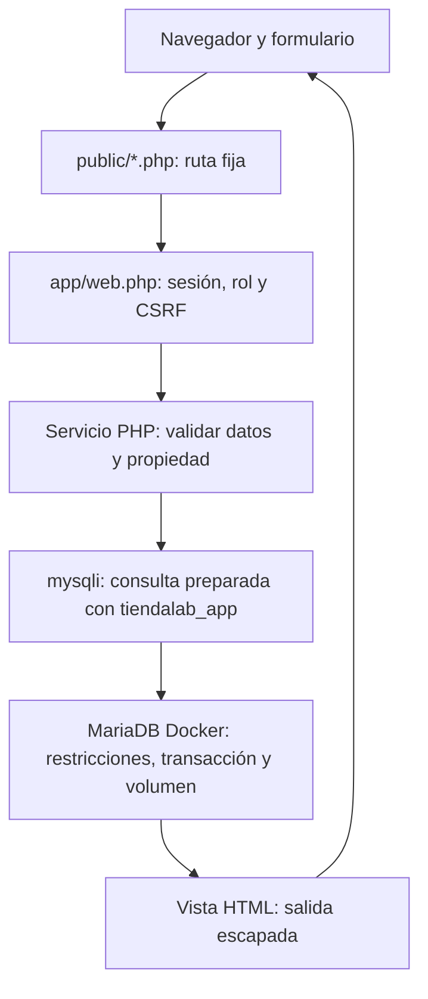

# Guía de seguridad y defensa de TiendaLab

**Estado vigente: fase 3 implementada y comprobada contra MariaDB real; fases 4/5 no iniciadas.** Las secciones 16 y 17 documentan el backend. Las secciones históricas conservan qué se hizo en fases previas; no describen el estado actual de las rutas reales. GitHub sigue público por autorización: los PDF incluyen nombres/carnets. Nunca publicar .env ni storage/.

Actualización: 18 de noviembre de 2026. Fases autorizadas y trabajadas: **0, 1, 2 y 3**. Esta guía separa implementación, pruebas realmente ejecutadas y recomendaciones Ubuntu.

## 1. Qué puedes afirmar hoy

“La tienda ya autentica usuarios, comprueba roles y guarda operaciones reales en MariaDB. Una compra bloquea existencias, crea factura y detalles y confirma todo o revierte todo. El vendedor solo edita lo suyo; el comprador solo consulta sus facturas. Lo probado es Windows/PHP con MariaDB en Docker Desktop. Ubuntu y las dos vulnerabilidades son fases posteriores.”

| Componente | Estado real | Lo que falta |
| --- | --- | --- |
| Escape HTML, rutas y cabeceras PHP | Comprobados con entradas reales/persistidas y maquetas | Ampliar auditoría en fase 6 |
| Prototipos locales y rechazo de POST | Maquetas aisladas y deshabilitadas por defecto; rutas reales separadas | No confundir con permisos reales |
| Formularios, roles y carrito reales | Conectados a sesiones y MariaDB; pruebas HTTP aprobadas | Auditoría ampliada fase 6 |
| Apache | No instalado/configurado por este trabajo | Fase 5 |
| Sesiones, autenticación y autorización por roles | Implementadas y probadas; revocación por baja/contraseña/rol | HTTPS/Ubuntu pendientes |
| MariaDB, mysqli, Docker y Compose | CLI y HTTP comprobados, privilegios limitados, transacciones reales | Ubuntu fase 5 |
| VM, firewall y red Ubuntu | No modificados ni probados | Fase 5 |
| IDOR y servicio TCP/8081 | No implementados; no se abrió 8081 | Fase 4 y prueba de red en fase 5 |
| Auditoría completa e instalación cronometrada | No ejecutadas | Fases 6 y 7 |

## 2. Cómo explicar la arquitectura y sus límites

El navegador solicita una página a Apache. PHP ejecuta la lógica en la VM. mysqli es el controlador con el que PHP consulta MariaDB. Docker mantiene la base en un contenedor con un volumen para sus datos. Compose describe cómo levantar ese contenedor de forma repetible. Apache y PHP **seguirán en Ubuntu**, fuera de Docker.

La VM separa el laboratorio del sistema anfitrión, pero por sí sola no garantiza aislamiento de red. El modo de su adaptador y las rutas importan. Una red puente puede conectar la VM a equipos que no forman parte del ejercicio: se debe usar la configuración indicada por el docente y comprobar sus límites, sin asumir que “estar en una VM” basta.

| Puerto | Destino final | Acceso previsto | Estado actual |
| --- | --- | --- | --- |
| TCP/80 | Apache, tienda | Equipos autorizados del laboratorio | No configurado |
| TCP/8081 | Apache, diagnóstico ficticio | Red autorizada; sin internet | No abierto por este trabajo |
| TCP/3306 | MariaDB en Docker | Solo 127.0.0.1 de la VM | Configurado y probado en Windows; VM pendiente |
| TCP/8000 | Vista previa PHP Windows | Solo 127.0.0.1 | Usado temporalmente para revisar fase 1 |
| TCP/8002 | Vista previa con prototipo desactivado | Solo 127.0.0.1 | Usado temporalmente para prueba negativa |

Los puertos 8000/8002 no forman parte de la entrega Ubuntu ni son vulnerabilidades elegidas. `127.0.0.1` significa el propio equipo; no es una IP para compartir con otro equipo.

## 3. Bitácora de comandos realmente ejecutados

Los comandos siguientes se ejecutaron en **PowerShell sobre Windows**, desde `C:\Users\aleja\Desktop\TiendaLab_Documentos_Codex`, salvo lectura del adjunto por ruta absoluta. Las rutas y datos de ejemplo no son secretos. Se omiten del texto las salidas de identidad Git para no duplicar información personal; no se cambiaron los valores. Los archivos de código se crearon mediante la herramienta de parches, no ejecutando comandos de configuración de Ubuntu.

### 3.1 Lectura y preparación, en orden

1. `Get-Content -LiteralPath 'C:\Users\aleja\.codex\attachments\29798d21-6494-441e-9182-f5c3746f89e3\Pasted text.txt' -Raw`: leyó las instrucciones autorizadas por el usuario.
2. `rg --files -g '!node_modules' -g '!vendor' -g '!dist' -g '!build' -g '!package-lock.json' -g '!yarn.lock' -g '!pnpm-lock.yaml' -g '!.git'`: inventarió los archivos; inicialmente solo estaban los dos PDF.
3. `Get-ChildItem -Force | Select-Object Name,Mode`: revisó contenido de la raíz. `Get-Command php,python,py,git,pdftoppm,pdftotext,node -ErrorAction SilentlyContinue | Select-Object Name,Source`: detectó herramientas. `git status --short --branch`: confirmó que todavía no existía un repositorio.
4. `python -c "import sys; print(sys.executable); import pypdf; print('pypdf OK'); import fitz; print('fitz OK')"`: falló en `pypdf` con el Python predeterminado. No es evidencia de haber usado fitz.
5. Se localizó el Python incluido mediante la herramienta de dependencias de Codex. Se ejecutó lo siguiente para extraer todas las páginas:

```powershell
& 'C:\Users\aleja\.cache\codex-runtimes\codex-primary-runtime\dependencies\python\python.exe' -c "import pypdf; from pathlib import Path; out=Path('tmp/pdfs'); out.mkdir(parents=True,exist_ok=True); [(out.joinpath(p.stem+'.txt').write_text('\n'.join('\\n=== PAGINA '+str(i+1)+' ===\\n'+(x.extract_text() or '') for i,x in enumerate(pypdf.PdfReader(p).pages)),encoding='utf-8'),print(p.name,len(pypdf.PdfReader(p).pages))) for p in Path('.').glob('*.pdf')]"
Get-Content -LiteralPath 'tmp\pdfs\DefinicióndelProyecto(1).txt' -Raw
Get-Content -LiteralPath 'tmp\pdfs\Propuesta_TiendaLab.txt' -Raw
pdftoppm -scale-to 1500 -png 'Propuesta_TiendaLab.pdf' 'tmp/pdfs/propuesta'
pdftoppm -scale-to 1300 -png 'DefinicióndelProyecto(1).pdf' 'tmp/pdfs/definicion'
```

Resultado: 6 y 11 páginas; 17 PNG inspeccionados. Poppler avisó de cajas de algunos glifos Type 3; no se ocultó el aviso y la inspección visual fue legible. Los renderizados son material de revisión, no código de aplicación.

6. `git config --get user.name` y `git config --get user.email`: identidad disponible. No se modificó la configuración global. Se buscaron instalaciones PHP en rutas habituales con `Get-ChildItem`; ninguna utilizable apareció. Las lecturas de `SKILL.md` y guías de herramientas no configuraron servicios del equipo.

### 3.2 PHP portátil: descarga y alcance de los permisos

```powershell
New-Item -ItemType Directory -Force -Path 'tools/php' | Out-Null
Invoke-WebRequest -Uri 'https://www.php.net/~windows/releases/latest/php-8.3-nts-Win32-vs16-x64-latest.zip' -OutFile 'tools/php.zip'
Expand-Archive -LiteralPath 'tools/php.zip' -DestinationPath 'tools/php' -Force
& '.\tools\php\php.exe' -v
```

El primer intento falló por resolución de nombre en el entorno restringido; por ello tampoco pudo extraerse ni ejecutarse el archivo inexistente. Se repitió con `$ErrorActionPreference = 'Stop'` y permiso de ejecución de la herramienta fuera de esa restricción. El segundo intento descargó, extrajo y ejecutó **PHP 8.3.36 CLI NTS**. No fue una elevación administrativa de Windows, no se cambió el firewall ni se instaló un servicio. El intérprete está dentro del proyecto y excluido de Git. NTS es suficiente para esta CLI; no es el módulo Apache de la entrega. Fuente: [descarga oficial de PHP para Windows](https://www.php.net/downloads.php?os=windows&version=8.3).

```powershell
Get-FileHash tools/php.zip -Algorithm SHA256
(Get-FileHash -LiteralPath 'tools/php.zip' -Algorithm SHA256).Hash
```

Huella local observada: `1A097D52B7A68622CDC723073B61CC70CAF79C941218FF65B2D8441DBC6B10D4`. Sirve para identificar este archivo descargado. **No se comparó con una firma o un hash publicado independiente**; no afirmar verificación criptográfica de origen. El enlace `latest` puede entregar otra revisión en el futuro.

### 3.3 Git local

```powershell
git init -b main
git add .gitignore .gitattributes '*.pdf'
git commit -m 'chore: preservar documentos oficiales y preparar repositorio'
git branch develop
git switch -c feature/fase-00-preparacion develop
git add docs REPORTES
git commit -m 'docs: analizar requisitos y completar fase 0'
git switch -c feature/fase-01-frontend
```

Se preservaron los PDF, se crearon las ramas permanentes y dos ramas de trabajo. `.gitignore` excluye temporales, PHP portátil y `.env`. Ignorar `.env` no borra secretos ya versionados: por eso no se crearon secretos. Los comandos posteriores de revisión `git remote -v`, `git branch --list` y `git status --short` confirmaron ausencia de remoto y trabajo en la rama de frontend. El cierre de esta fase se registra en el reporte 01 y en `git log`; no se inventa un PR.

### 3.4 Sintaxis, servidores de prueba y comprobaciones

```powershell
Get-ChildItem -Path app,demo,public -Filter '*.php' -Recurse |
  ForEach-Object { & '.\tools\php\php.exe' -l $_.FullName }
node --check public/assets/js/app.js
node --check public/assets/js/carrito.js
```

`php -l` analiza sintaxis, sin ejecutar una compra ni conectarse a una base. `node --check` comprueba sintaxis JavaScript; Node es una herramienta de pruebas, no el servidor ni una dependencia de la tienda.

Se ejecutaron estos dos arranques en procesos separados:

```powershell
$env:TIENDALAB_PROTOTIPO='1'
& '.\tools\php\php.exe' -S 127.0.0.1:8000 -t public
```

```powershell
$env:TIENDALAB_PROTOTIPO='0'
& '.\tools\php\php.exe' -S 127.0.0.1:8002 -t public
```

`-S` inicia el servidor de desarrollo de PHP. `-t public` limita la raíz de documentos servidos: `demo/`, `app/`, `docs/` y `.git/` quedan fuera. La variable habilita o bloquea el prototipo; no autentica a nadie.

```powershell
& '.\scripts\verificar-frontend.ps1' 2>&1 |
  Tee-Object -FilePath 'tmp/verificacion-frontend.txt'
```

La primera ejecución pasó sintaxis y cálculos, pero falló HTTP con `EACCES 127.0.0.1:8000`. Los primeros procesos se detuvieron con Ctrl+C y se volvieron a iniciar con permiso de la herramienta para acceder a loopback. Se repitió el mismo comando: **22 PHP válidos, 3 pruebas de cálculo aprobadas y 53 comprobaciones HTTP aprobadas**. No se desactivaron controles del sistema.

El script ejecuta, en orden: sintaxis PHP, `node --check public/assets/js/app.js`, `node --test tests/frontend.test.cjs` y `node tests/http.test.cjs 8000 8002`. `Tee-Object` muestra y guarda la salida. El archivo de evidencia estable se conserva en `REPORTES/evidencias/verificacion-frontend.txt`.

Después se añadió `tests/security.test.php` y su ejecución, entre sintaxis PHP y JavaScript, al script de verificación. Se ejecutó `& '.\scripts\verificar-frontend.ps1' 2>&1 | Tee-Object -FilePath 'REPORTES/evidencias/verificacion-frontend.txt'`: los resultados finales incluyen **8 comprobaciones PHP** (escape, IP local/externa/cabecera de proxy, ausencia de IP, bandera desactivada/ausente, moneda), las 3 pruebas JS y las 53 HTTP, todas aprobadas. La IP externa de esa prueba se simula dentro del proceso PHP; **no equivale a una prueba desde otra máquina**.

La revisión posterior `rg -n 'https?://|fetch\(|XMLHttpRequest|innerHTML|session_start|mysqli|password_hash' app public demo` encontró solamente los namespaces SVG `http://www.w3.org/2000/svg`; estos son identificadores XML, no descargas de red. `git diff --check` no reportó errores. Los ficheros SVG se generaron localmente con iniciales y gradientes, sin descargar imágenes.

Se ejecutó también `Get-NetTCPConnection -State Listen -LocalPort 8000,8002 -ErrorAction SilentlyContinue | Select-Object LocalAddress,LocalPort,OwningProcess`; no produjo registros útiles en la salida capturada. **No se utiliza como prueba de sockets o firewall**. La evidencia de loopback es el parámetro de arranque, la guardia PHP y las peticiones locales, no una prueba desde otro equipo.

La comprobación en Edge se hizo por la herramienta de navegador, no por comandos de Ubuntu. Se revisaron DOM, capturas y acciones de búsqueda, formularios, carrito, factura, vendedor y usuarios. La adaptación móvil se revisó con viewport de 390×844; tras corregir el contenedor de la tabla, el ancho de documento y el disponible coincidieron en 375 px (resto reservado por scrollbar). Hay capturas reales en `REPORTES/evidencias/`.

Se comprobó además el ancho de las otras diez pantallas; todos los resultados fueron correctos y quedaron en `REPORTES/evidencias/responsive.json`. La inspección de consola al final devolvió una lista vacía de errores/avisos capturados. Dos intentos de captura de registro agotaron el tiempo de la herramienta; se volvió a esa pantalla y la captura final sí se guardó. La selección automatizada de un JPG local no pudo completarse porque la extensión de Edge no tenía permiso de acceso a URLs de archivo. No se cambió ese permiso ni se afirmó que la previsualización de archivo quedara probada. Las imágenes de fixtures y la previsualización de un producto existente sí se observaron.

## 4. Controles iniciales de fase 1 (histórico; fase 3 en sección 17)

### 4.1 Raíz pública pequeña

- **Qué:** el servidor recibe `-t public`. El código reutilizable y datos de demostración viven fuera de esa raíz.
- **Archivos:** `scripts/iniciar-frontend.ps1`, `app/`, `demo/`, `public/`.
- **Cómo protege:** una petición HTTP no obtiene directamente fuentes, documentos internos o el repositorio. Esto no sirve si alguien cambia DocumentRoot a la raíz del proyecto: hay que conservarlo en Apache.
- **Prueba ejecutada:** peticiones a `/app/bootstrap.php`, `/demo/datos.php`, `/docs/ALCANCE.md` y `/.git/config`: HTTP 404.
- **Explicación oral:** “Solo `public` es el escaparate. El resto del código queda detrás del mostrador.”

### 4.2 Prototipos desactivados por defecto y rutas permitidas

- **Qué:** `prototype_enabled()` exige `TIENDALAB_PROTOTIPO=1` y `REMOTE_ADDR` loopback. No confía en `X-Forwarded-For`. `public/prototipo/index.php` usa una lista cerrada de vistas, comprueba tipos y acepta solo ejemplos de factura 1, 3 y 4.
- **Cómo protege:** no se forman rutas de archivos con texto arbitrario; una consulta desconocida o un parámetro en forma de arreglo recibe 404. Los paneles son maquetas locales, no rutas finales sin protección.
- **Prueba ejecutada:** prototipo desactivado=404; vista desconocida/arreglo/ruta de archivo=404; ejemplo 2/arreglo=404; rutas finales `/admin.php` y `/factura.php?id=2`=404.
- **Límite:** la lista de ejemplos no es autorización por propietario. La autorización real se implementará con sesión; aquí no hay usuarios autenticados. La guardia no es adecuada detrás de un proxy que convierta toda conexión en loopback: el prototipo no debe desplegarse habilitado.
- **Explicación oral:** “Para revisar el diseño abrí una puerta local de demostración, cerrada por defecto; todavía no es el panel de producción.”

### 4.3 Escape de salida y DOM sin HTML de usuario

- **Qué:** `e()` en `app/bootstrap.php` usa `htmlspecialchars` con `ENT_QUOTES | ENT_SUBSTITUTE` y UTF-8. Las plantillas escapan textos y atributos. `public/assets/js/app.js` usa `textContent`, `createElement` y asignación de valores, no inserta la búsqueda como HTML.
- **Para qué:** caracteres especiales se muestran como datos dentro del contexto HTML esperado. No cambia ni valida el significado comercial de un dato. [Referencia oficial de htmlspecialchars](https://www.php.net/manual/en/function.htmlspecialchars.php).
- **Comprobación:** revisión de plantillas y prueba HTTP sin errores; buscador sin coincidencias funciona. La auditoría con entradas persistidas queda pendiente porque no existe backend.
- **Prueba específica adicional:** `tests/security.test.php` comprobó el escape de etiquetas, comillas simples/dobles y ampersand. Fue ejecutada y pasó; no sustituye una auditoría completa de todos los contextos.
- **Explicación oral:** “Un nombre que contiene símbolos debe mostrarse como nombre, no convertirse en una etiqueta que el navegador ejecute.”

### 4.4 Cabeceras y bloqueo de envíos

Archivo: `app/bootstrap.php`. Aplicadas a respuestas PHP:

| Control | Función | Comprobación real |
| --- | --- | --- |
| `Content-Type: text/html; charset=UTF-8` | Define formato y codificación de la página | Páginas renderizadas con acentos |
| `X-Content-Type-Options: nosniff` | Evita reinterpretaciones de tipo de contenido en contextos relevantes | Cabecera presente en las 11 pantallas |
| `Referrer-Policy: no-referrer` | Evita enviar la URL de origen como Referer | Inspección de código; no captura de tráfico externa |
| `Cache-Control: no-store` | Indica no almacenar la respuesta en caché | Cabecera comprobada en HTTP |
| CSP `default-src 'self'` | Recursos propios como regla base | Recursos locales comprobados |
| CSP `script-src/style-src 'self'` | JS/CSS locales, sin inline | Sin handlers inline en las respuestas comprobadas |
| CSP `img-src 'self' blob:` | Imágenes locales y previsualización temporal | Imágenes del catálogo cargadas |
| CSP `connect-src 'none'` | No permite fetch/XHR/conexiones de la interfaz | Se inspeccionó la política; el código no hace peticiones |
| CSP `form-action 'none'` | Bloquea envío de formularios en esta fase | Cabecera HTTP comprobada; botones solo validan |
| CSP `object-src/base-uri/frame-ancestors 'none'` | Evita objetos incrustados, cambio de base y enmarcado | Código inspeccionado; no prueba específica de iframe |
| GET/HEAD únicamente | Rechaza operaciones de escritura | POST a login devuelve 405 y Allow GET, HEAD |

Estas cabeceras no son un WAF, no comprueban dueños de facturas y no cierran puertos. Por tanto, no anulan las dos vulnerabilidades elegidas. La política `form-action 'none'` y el rechazo global de POST son específicos del prototipo: **deberán cambiar en fase 3** por POST permitido solo en acciones previstas con validación y CSRF. No se prometerá que la política actual sirva sin cambios para el backend.

Explicación oral: “El navegador recibe reglas para cargar solo nuestros recursos. El servidor también rechaza envíos; no depende solo del botón desactivado.”

### 4.5 Datos ficticios, carrito y archivos

- `demo/datos.php`: ejemplos sin hashes ni contraseñas; dominios `.test`. El resumen administrativo reproduce cuatro facturas y $459.50 del anexo; el comprador solo visualiza tres ejemplos de Ana. El cuarto total del anexo corresponde a $145.77; no hay endpoint para esa factura ajena.
- `app.js`: sessionStorage guarda únicamente ID y cantidad del carrito de muestra. No guarda nombres, correos, contraseñas, roles, tokens ni precios. Se recalcula con los fixtures y se validan cantidades enteras y límites. No es una fuente confiable para una compra futura: el servidor deberá volver a calcular todo con la base.
- `carrito.js`: dinero en centavos enteros; IVA redondeado una vez sobre subtotal. El caso del anexo y casos vacío/límites pasaron.
- Formularios: validan en navegador, no tienen nombres de parámetros para enviar datos y sus botones son `type="button"`. La política CSP y el rechazo de POST refuerzan la separación. Al revisar un formulario válido se limpian las contraseñas de prueba; no se crean cuentas.
- Imagen: `accept`, tipo declarado JPG/PNG/WEBP y máximo 2 MB limitan la previsualización. `URL.createObjectURL` crea una URL temporal local que se revoca al reemplazarla. **Esto no es validación segura de una subida real**: en fase 3 se comprobará el archivo en servidor y se impedirá ejecutar contenido subido.
- Borrar/guardar/confirmar muestran avisos explícitos sin alterar fixtures o existencias. El carrito sí cambia temporalmente, porque es una interacción visual autorizada.

Explicación oral: “En fase 1 pruebo cómo se usa la tienda. Los precios del navegador nunca serán la autoridad para cobrar o descontar inventario.”

## 5. Plan original de autenticación (histórico; implementado en fase 3, sección 17)

### Autenticación y contraseñas

Autenticar es comprobar quién es el usuario. El backend buscará su correo con mysqli parametrizado y verificará la contraseña frente a un hash con las funciones nativas de PHP. Un hash no se descifra para recuperar la contraseña; se verifica la candidata. No usar MD5, SHA simple ni guardar texto plano. El registro impondrá comprador desde el servidor, aunque se manipule el formulario. [Funciones de hash de PHP](https://www.php.net/manual/en/function.password-hash.php).

Archivos previstos: módulo de autenticación y acciones de login/registro, aún no creados. Pruebas futuras: contraseña correcta/incorrecta, correo duplicado, registro con rol manipulado, respuesta genérica, límite de intentos. La ausencia de límites no será una tercera vulnerabilidad deliberada.

Explicación oral: “La contraseña demuestra identidad. El servidor decide el rol; el navegador no puede nombrarse administrador.”

### Sesiones

Una sesión permitirá relacionar varias peticiones con un usuario ya autenticado. Se planifica modo estricto, ID regenerado tras login, cookie HttpOnly, SameSite, expiración e invalidación al salir. No habrá IDs de sesión en la URL. El atributo Secure requiere HTTPS: como la arquitectura aprobada usa HTTP en laboratorio, no debe activarse ciegamente y luego fingir que las sesiones funcionan. Tampoco se declarará cifrado del tráfico HTTP. Solo se usarán credenciales ficticias del laboratorio. [Configuración de seguridad de sesiones PHP](https://www.php.net/manual/en/session.security.ini.php).

Pruebas futuras: no entrar a paneles sin cookie; comprobar regeneración, expiración, logout e inaccesibilidad de la sesión cerrada. Actualmente las respuestas no emiten `Set-Cookie`; eso se verificó en los tests HTTP. sessionStorage del carrito **no** es una sesión de autenticación.

Explicación oral: “La cookie es un identificador de sesión; los permisos viven en el servidor, no en un selector de la pantalla.”

### Autorización, CSRF y datos

Autorizar es decidir qué puede hacer una identidad. Se comprobarán roles y propiedad en cada operación: vendedor sobre sus productos, comprador sobre su historial, administrador sobre productos/usuarios. Solo la propiedad de una factura concreta se omitirá deliberadamente en fase 4. Ocultar botones no sustituye estas comprobaciones.

Los cambios usarán POST y un token CSRF ligado a la sesión. SameSite ayuda, pero no reemplaza el token. Las cantidades, existencias y totales se validarán de nuevo en el servidor. La compra deberá ser transaccional para que factura, detalle y descuento de stock se confirmen juntos o no se aplique ninguno.

Pruebas futuras: comprador solicitando una acción administrativa, vendedor editando producto ajeno, POST sin token, compra con stock insuficiente, concurrencia y rollback. No ejecutadas en fase 1.

## 6. Plan original de MariaDB (histórico; implementación en secciones 14 y 17)

- MariaDB almacenará usuarios, productos, facturas y detalles. Su usuario de aplicación tendrá los permisos mínimos necesarios; la aplicación no usará root. Las credenciales reales de instalación no entrarán a Git, capturas ni esta guía.
- mysqli enviará consultas preparadas con parámetros; separar estructura SQL y valores evita tratar un dato como parte de la consulta. Parametrizar no comprueba permisos ni propiedad: una consulta preparada puede seguir teniendo IDOR. [Consultas preparadas mysqli](https://www.php.net/manual/en/mysqli.quickstart.prepared-statements.php).
- Compose publicará MariaDB en `127.0.0.1:3306` del host de la VM y usará un volumen persistente. Publicar simplemente `3306:3306` puede escuchar en interfaces externas; se evitará. También se comprobará que la red de Docker no cree una ruta externa inesperada. Las versiones y modos de Docker importan: la documentación advierte sobre diferencias de aislamiento, por lo que se verificará desde otro equipo autorizado. [Publicación de puertos de Docker](https://docs.docker.com/engine/network/port-publishing/).
- El volumen conserva datos después de recrear el contenedor; no es por sí solo una copia de seguridad. No ejecutar `down -v` sobre datos que se deban conservar.

Actualización fase 2: `compose.yaml`, `database/init/*.sql`, `.env` local ignorado y prueba CLI `tests/database.test.php` ya existen. Se comprobó levantar MariaDB, consultar con mysqli, reiniciar y recrear conservando un dato modificado, en Windows/Docker Desktop. Faltan configuración web, acceso desde Ubuntu y prueba desde otro equipo; no atribuirles los resultados locales. Ver secciones 14 y 15.

Explicación oral: “Docker hace repetible la base. mysqli es el puente desde PHP. El puerto de la base queda en el interior de la VM, no en el mostrador de la red.”

## 7. Apache, PHP, firewall y red Ubuntu: plan

Apache tendrá un VirtualHost para la tienda con DocumentRoot apuntando a `public/`, sin listados de directorios. La configuración del diagnóstico usará otra raíz. Se limitará la escritura del usuario de Apache a los directorios que de verdad la necesiten; no se usará `chmod 777`. PHP tendrá errores registrados fuera de la raíz pública y mensajes genéricos para usuarios; no se publicará `phpinfo()`. No se han creado vhosts ni modificado php.ini del sistema. [DocumentRoot y opciones de Apache](https://httpd.apache.org/docs/2.4/mod/core.html#documentroot).

El firewall filtrará conexiones de acuerdo con la red autorizada, manteniendo 80 y 8081 disponibles desde los equipos del ejercicio. No se abrirá 3306 a la LAN ni se añadirá SSH como requisito nuevo. Si la VM se administra por SSH, cualquier cambio deberá evitar perder ese acceso y considerar las indicaciones del docente. Docker administra reglas de red propias: comprobar UFW es necesario pero no suficiente para demostrar aislamiento de contenedores. [Firewall en Ubuntu Server](https://documentation.ubuntu.com/server/how-to/security/firewalls/).

La IP, interfaz y subred reales se documentarán en fase 5 después de observarlas y recibir las instrucciones del laboratorio. No se adivinan aquí ni se crean reglas de firewall generales como “permitir desde cualquier lugar”.

Explicación oral: “Apache decide qué sitio responde; PHP ejecuta la aplicación; el firewall decide desde dónde se puede llegar. Cada capa tiene una tarea distinta.”

## 8. Comandos de Ubuntu recomendados, NO ejecutados

Esta es una lista de lectura y verificación para la fase correspondiente, **no un instalador ya probado**. Ejecutarlos solo en la VM propia. El orden permite conocer el entorno antes de cambiarlo. No se ofrecen cambios de red automáticos hasta conocer interfaz, subred y acceso de administración.

| Orden | Comando previsto | Qué comprueba | Fase |
| --- | --- | --- | --- |
| 1 | `cat /etc/os-release` | Distribución y versión real | 5 |
| 2 | `ip -br address` | Interfaces y direcciones asignadas | 5 |
| 3 | `ip route` | Rutas, puerta de enlace y posible salida externa | 5 |
| 4 | `sudo ss -lntp` | Sockets TCP en escucha y procesos | 5 |
| 5 | `sudo ufw status verbose` | Estado y política del firewall | 5 |
| 6 | `apache2ctl -v` | Versión de Apache instalado | 5 |
| 7 | `sudo apache2ctl configtest` | Sintaxis del servidor antes de recargarlo | 5 |
| 8 | `sudo apache2ctl -S` | VirtualHosts efectivos | 5 |
| 9 | `systemctl is-active apache2` | Servicio activo o no | 5 |
| 10 | `php -v` | Versión CLI; no demuestra por sí sola versión del módulo Apache | 3/5 |
| 11 | `php -m` | Extensiones CLI, incluida mysqli; comprobar aparte SAPI web | 3/5 |
| 12 | `docker version` | Versiones cliente/servidor del motor | 2/5 |
| 13 | `docker compose version` | Disponibilidad de Compose | 2/5 |
| 14 | `docker compose config --quiet` | Validez de Compose sin volcar variables o secretos | 2/5 |
| 15 | `docker compose ps` | Estado de servicios del proyecto | 2/5 |
| 16 | `curl -I http://127.0.0.1/` | Estado y cabeceras de la tienda | 5/6 |

No se ejecutaron `apt install`, `ufw enable`, reglas `ufw allow`, `netplan apply`, `a2ensite`, `systemctl reload`, `docker compose up` ni cambios SQL. Sus comandos exactos se añadirán cuando se implementen y prueben en sus fases, junto con salidas y archivos reales. Esto evita documentar un despliegue inventado.

## 9. Las dos vulnerabilidades intencionales

### A. IDOR de factura (prevista para fase 4)

- **Qué significa:** referencia directa a un objeto sin comprobar si pertenece al solicitante. Identificar un objeto por número no es el fallo; omitir autorización sobre ese objeto sí.
- **Ubicación prevista:** `factura.php?id=`, detrás de autenticación real. En fase 3 esa ruta ya existe y está protegida por `buyer_invoice` en app/shop.php: exige id y comprador_id de sesión. La prueba entre dos compradores rechaza la lectura ajena con 404. No se ha introducido la omisión de fase 4.
- **Por qué existirá:** demostrar una falla de autorización sobre datos ficticios en el ejercicio aprobado. No se omitirá la sesión ni se extenderá a historial o productos.
- **Impacto acotado:** un comprador de laboratorio podría leer un documento ficticio ajeno; no debe modificarlo, borrar datos ni obtener control del equipo.
- **Cómo corregir:** exigir en servidor que la factura pertenezca al comprador autenticado o que exista un permiso explícito para esa operación. Validar el ID o usar una consulta preparada no basta para corregir propiedad.
- **Cómo comprobar en fase 4:** preparar dos cuentas ficticias con facturas conocidas, verificar primero que sin sesión no hay acceso, comprobar la lectura propia y después la lectura ajena prevista por el ejercicio; guardar evidencia con identidades ficticias. En una variante corregida, la lectura ajena debe denegarse. No se ha ejecutado esta prueba.
- **Defensa sencilla:** “La puerta reconoce quién entró, pero en esa única consulta olvidamos comprobar de quién es el documento. El arreglo es autorizar el documento, no quitar números de la URL.”

### B. Diagnóstico expuesto en TCP/8081 (previsto para fase 4)

- **Qué significa:** un servicio interno de diagnóstico accesible desde la red autorizada cuando no debería estar disponible para compradores.
- **Ubicación prevista:** Apache en 8081, raíz independiente, sin enlaces desde la tienda. No existe servicio en esta fase.
- **Por qué existirá:** representar una mala configuración del servidor sin utilizar secretos ni comandos reales. La página mostrará valores estáticos inventados, no información tomada del sistema.
- **Impacto acotado:** exposición de información ficticia. No tendrá consola, shell, archivos reales, contraseñas reales ni administración del sistema.
- **Cómo corregir:** retirar el listener y sitio cuando no sea necesario, o restringir el acceso a una interfaz/origen administrativo autorizado. Quitar un enlace no cierra un servicio. La mitigación se documentará sin cerrar accidentalmente el ejercicio antes de su evaluación.
- **Cómo comprobar en fase 4/5:** desde el segundo equipo expresamente autorizado, verificar disponibilidad de 8081 en la VM del proyecto y lectura de la página; confirmar que sus datos son ficticios y que la tienda no la enlaza. Luego comprobar el cierre o restricción en la variante corregida. No hay resultados todavía.
- **Defensa sencilla:** “La aplicación puede controlar bien sus roles y aun así el servidor dejar otra puerta abierta. El fallo está en exponer ese servicio, aunque no tenga enlace.”

El entorno se limita a VM y red del laboratorio. No se prueban otros equipos, infraestructura institucional o internet. No se introducen SQLi, XSS, RCE ni un login deliberadamente sin límites. La ausencia absoluta de defectos no se garantiza por declaración: se audita.

## 10. Práctica histórica de maquetas de fase 1 (backend actual en sección 17)

1. Inicia la vista previa siguiendo README y abre el catálogo. Explica que las tarjetas son HTML generado por PHP con datos de `demo/datos.php`.
2. Muestra el aviso de fase 1. Recorre comprador/vendedor/admin desde “Revisar pantallas”, explicando que no has iniciado sesión.
3. Carga el carrito del anexo. Explica centavos, subtotal 7399, IVA 962 y total 8361. Al confirmar se informa que no existe una compra.
4. Abre factura de ejemplo e historial. No afirmes que se generaron al pulsar confirmar.
5. Muestra `app/bootstrap.php`: escape, cabeceras y rechazo de POST. Luego `public/prototipo/index.php`: habilitación y lista cerrada de rutas.
6. Explica cómo la futura autenticación será distinta de una maqueta. Usa el cuadro de estado al principio de esta guía.
7. Para repetir pruebas, arranca también el servidor con `-SinPrototipo -Port 8002` y ejecuta el script de verificación. Es necesario Node para los tests, pero no para ver la tienda.
8. Cierra ambos procesos con Ctrl+C después de practicar.

Preguntas útiles: “¿Una consulta preparada corrige IDOR?” No, corrige separación de consulta/datos, no propiedad. “¿Un rol en JavaScript protege al servidor?” No. “¿El diagnóstico está protegido por no tener enlace?” No. “¿Docker protege automáticamente la base de la LAN?” No, hay que publicar correctamente y probar. “¿La instalación tarda menos de 30 minutos?” Todavía no se ha medido en una VM limpia.

## 11. Regla para actualizar esta guía en fases posteriores

Cada nuevo control tendrá fecha, objetivo, comandos exactos en orden, archivos modificados, explicación de funcionamiento, evidencia real, límites y explicación oral. Mover de “plan” a “implementado” solamente después de crear el componente; mover a “comprobado” solamente después de ejecutarlo. Registrar fallos y correcciones, sin reemplazarlos por un resultado ideal. No incluir secretos, tokens, cookies activas, contraseñas reales ni datos de terceros.

La matriz de requisitos y los reportes por fase deben actualizarse al mismo tiempo. Las fuentes oficiales enlazadas orientan los controles; no sustituyen la definición del docente ni autorizan nuevas tecnologías o fases.

## 12. Cierre verificado de fase 1

Actualización posterior: el usuario autorizó publicación privada y organización GitFlow, sin iniciar fase 2. El estado vigente del remoto está en `REPORTES/ESTADO_GITFLOW.md`; las menciones anteriores a ausencia de remoto son históricas.

Se comprobaron los dos scripts PowerShell con `System.Management.Automation.Language.Parser.ParseFile`: ambos sin errores de sintaxis. Un script de Python recorrió enlaces Markdown locales de README, docs y reportes: ninguno apuntaba a un archivo inexistente. Estas comprobaciones no configuran seguridad del sistema.

El intento inicial de `git add app demo public scripts tests` y commit falló al crear `.git/index.lock` por permisos del entorno. No se borró ningún lock ni se cambiaron ACL. Se repitió con autorización de la herramienta y se ejecutó esta secuencia:

```powershell
git add app demo public scripts tests
git diff --cached --check
git commit -m 'feat: construir frontend local de TiendaLab con prototipos aislados'
```

Resultado: commit local `5deaa9c`, 41 archivos de código, assets, scripts y tests; chequeo de espacios sin errores. Los avisos de conversión CRLF/LF son de finales de línea entre Windows/Linux, no fallos de la aplicación.

Los dos servidores de prueba se detuvieron enviando Ctrl+C a sus procesos. El código de salida 1 corresponde a esa interrupción voluntaria, no a un error funcional de la tienda. Para practicar se deben iniciar de nuevo según README. No quedaron servicios de base de datos o diagnóstico creados por esta fase.

La documentación y evidencias se guardan en un segundo commit local de cierre, sin push. Su identificador exacto puede consultarse con `git log --oneline -4`; no se incluye dentro del archivo para evitar una referencia circular al propio commit.

## 13. Publicación inicialmente privada y GitFlow (registro histórico)

Esta sección describe la creación inicial. **El estado actual es público**, por autorización posterior; no interpretar las referencias históricas a privacidad como protección vigente. Ver sección 15 y ESTADO_GITFLOW.md.

Por autorización explícita se revisaron `git status --short --branch`, `git log --all --oneline --graph`, `git remote -v`, `git ls-files`, `.gitignore` y la disponibilidad de gh. gh no estaba instalado; `git config --get credential.helper` indicó manager. Se obtuvo la credencial mediante `git credential fill` exclusivamente en memoria y se consultó GET /user y GET /repos/Vasquezzz247/TiendaLab-SED. La segunda consulta devolvió 404 antes de crear el repositorio.

Se añadieron exclusiones a .gitignore y se ejecutó `git add .gitignore`, commit bd88660 y búsqueda textual de patrones de tokens/claves privadas, sin coincidencias. No se subieron tmp ni herramientas. En ese momento los PDF y las rutas locales permanecían en el repositorio privado; posteriormente el usuario autorizó hacerlo público, incluyendo esa información académica.

Orden posterior real: API POST /user/repos con private=true y auto_init=false; `git remote add origin https://github.com/Vasquezzz247/TiendaLab-SED.git`; `git push -u origin main develop feature/fase-00-preparacion feature/fase-01-frontend`; PATCH del repositorio con default_branch=main. POST /pulls creó PR #1 y #2 con base develop; PUT /pulls/numero/merge usó merge_method=merge y SHA esperado del head. Se conservan los commits originales.

Se ejecutaron `git fetch origin`, `git switch develop`, `git merge --ff-only origin/develop`, `git switch -c feature/gitflow-documentacion`, commit documental y `git push -u origin feature/gitflow-documentacion`; el PR #3 se creó y fusionó del mismo modo. Luego fetch, switch develop, merge --ff-only, `git switch -c feature/fase-02-base-datos` y `git push -u origin feature/fase-02-base-datos`. API GET del repositorio, /branches y /pulls?state=all, más `git branch -vv` y `git ls-remote --heads origin`, verifican referencias y PR reales. El cierre documental se integra por PR adicional y las ramas develop/fase-02 se actualizan por fast-forward; no es implementación de fase 2.

No hubo force push, reescritura de historial, cambios de permisos del sistema ni credenciales en archivos. No se configuraron protecciones obligatorias de ramas ni se afirma que existan. Main permanece como base reservada hasta preparar una entrega estable.

## 14. Corrección de auditoría y fase 2 — ejecutado el 18/11/2026

### Qué cambió, para qué y cómo explicarlo

| Archivo | Control / finalidad | Explicación oral |
| --- | --- | --- |
| scripts/router.php | Lista explícita de páginas; assets dentro de ruta real; 404 para lo demás, incluido byte nulo | El servidor de desarrollo ya no responde con catálogo cuando una dirección no existe |
| scripts/iniciar-frontend.ps1 | Arranca PHP con ese router | Las pruebas tienen un entorno definido y reproducible |
| compose.yaml | Solo MariaDB; imagen por digest; host loopback; volumen; healthcheck; init de solo lectura | El contenedor guarda la base, el volumen conserva datos y el puerto solo recibe conexiones del propio host |
| scripts/preparar-entorno.php | Dos secretos con random_bytes; archivo exclusivo, no sobrescribir; 0600 en Unix | Las claves de administración no son las contraseñas públicas de ejemplo |
| database/init/01-schema.sql | InnoDB, PK/FK, correo único, CHECK, ENUM, DECIMAL, columnas monetarias generadas | La base rechaza referencias inexistentes, valores inválidos y cálculos de IVA manipulados |
| database/init/02-seed.sql | Datos ficticios y bcrypt con sal distinta | La base guarda verificadores, no contraseñas de usuarios en claro |
| database/init/03-permisos.sql | Revoca permisos de esquema por defecto y concede solo CRUD a la aplicación | PHP podrá trabajar con datos, no crear ni borrar tablas |
| tests/database.test.php | CLI mysqli, consultas, rechazos y verificaciones; fuera de public | Verifico compatibilidad de conexión sin construir el login ni cambiar los formularios |
| scripts/verificar-base.ps1 | Comprueba salud, binding y persistencia con dato modificado | No confundo volver a cargar el seed con conservar datos |

### Comandos reales en orden

Se ejecutaron en PowerShell desde la raíz del proyecto. En esta tabla `docker` equivale al ejecutable `C:\Program Files\Docker\Docker\resources\bin\docker.exe`; `php` al portátil `tools/php/php.exe`. Ninguno de estos comandos instala Apache ni configura Ubuntu.

1. `git status --short --branch`, lectura de AGENTS, alcance/matriz y texto íntegro de los PDF. Una extracción nueva con pypdf comprobó 6/11 páginas y coincidencia con el texto releído. No cambiaron los originales.
2. `docker version`, `docker compose version`, `docker ps --format '{{.Names}} {{.Ports}}'`, `docker image ls --format '{{.Repository}}:{{.Tag}}'`: Docker Engine 28.3.0, Compose 2.38.1; sin contenedores en ejecución al comenzar. Se reutilizó la rama existente feature/fase-02-base-datos.
3. `php scripts/generar-seed.php`: creó SQL ficticio con password_hash bcrypt; la contraseña de demo está documentada separadamente en BASE_DE_DATOS.md. `php scripts/preparar-entorno.php`: creó .env con secretos aleatorios, sin mostrarlos.
4. `docker compose config --quiet`: configuración válida, sin imprimir expansión de secretos. `docker compose up -d --wait --wait-timeout 180`: descargó inicialmente mariadb:11.4, creó red/volumen/contenedor, ejecutó init y llegó a Healthy.
5. Se iniciaron dos procesos PHP ocultos con `Start-Process ... -S 127.0.0.1:8000 -t public scripts/router.php` y equivalente puerto 8002, con TIENDALAB_PROTOTIPO=1 y =0. `scripts/verificar-frontend.ps1 2>&1 | Tee-Object REPORTES/evidencias/fase02-frontend.txt` pasó. `Stop-Process` detuvo solo los dos PID creados. No hay prueba PHP Linux/Apache.
6. `scripts/verificar-base.ps1 2>&1 | Tee-Object REPORTES/evidencias/fase02-base.txt`: config --quiet; up --wait; `php -d extension_dir=.../tools/php/ext -d extension=mysqli tests/database.test.php`; inspect de PortBindings y nombre de volumen; test mark; compose restart db; up --wait; verify-marker; up --force-recreate --wait db; verify-marker; restore; suite final; compose ps. Todas las etapas completadas. El script publicado contiene los argumentos exactos y aborta ante errores.
7. `docker image inspect mariadb:11.4 --format '{{index .RepoDigests 0}}'`: obtuvo el digest guardado en compose.yaml; `docker compose exec -T db mariadb --version`: 11.4.13. `docker compose port db 3306`: 127.0.0.1:3306. `php -l` comprobó los PHP nuevos de scripts/tests.
8. Se fijó la imagen por digest y se ejecutó de nuevo config --quiet y up --wait. `docker tag mariadb:11.4 tiendalab-mariadb:11.4.13`; `docker save -o tmp/tiendalab-mariadb.tar tiendalab-mariadb:11.4.13`: exportación real para traslado. No se exportaron secretos ni datos del volumen.
9. `docker compose logs --no-color --tail 100 db` guardado en `REPORTES/evidencias/fase02-mariadb.log.txt`. Hay avisos de memory.pressure y fallback de io_uring a libaio; no se cambió la seguridad del host para suprimirlos. El servidor llega a ready for connections y Healthy.
10. Suite mysqli final, compose ps/port, `Get-NetTCPConnection -State Listen -LocalPort 3306`, `Get-Item tmp/tiendalab-mariadb.tar` y `Get-FileHash ... -Algorithm SHA256` se guardaron en fase02-final.txt. Socket observado en Windows: 127.0.0.1:3306. El tar mide 105682432 bytes; hash en la evidencia. `git check-ignore .env tmp/tiendalab-mariadb.tar` confirma exclusión.

### SQL realmente ejecutado

El entrypoint ejecutó `01-schema.sql`, `02-seed.sql` y `03-permisos.sql` en el volumen nuevo. Los archivos contienen el DDL, INSERT/COMMIT y REVOKE/GRANT completos; no se ejecutó el seed contra un volumen preexistente. La suite ejecuta los SELECT y operaciones negativas exactas que se pueden estudiar en tests/database.test.php. Los cambios negativos están dentro de transacciones con rollback; los errores de permisos no se confunden con operaciones exitosas. El marcador cambia solo el nombre ficticio de Carla y lo restaura al terminar.

Resultados: 5 usuarios, 9 productos, 4 facturas, 7 líneas, 4 FK, cinco hashes verificables, total 459.50, Ana propietaria de 1/3/4 y Luis de 2; 24 comprobaciones aprobadas antes y después de persistencia. Consulta mysqli preparada desde Windows devolvió el nombre con acento correctamente. Restricciones rechazaron stock negativo, precio cero, vendedor inexistente, correo repetido, rol desconocido, cantidad cero y eliminación de comprador referenciado. El usuario app no puede CREATE TABLE.

### Límites que debes poder explicar

- Escuchar en 0.0.0.0/:: **dentro** del contenedor, como indica el log, no equivale al binding del host. El host está limitado a 127.0.0.1 por Docker y fue observado con Get-NetTCPConnection. No se probaron conexiones desde otra computadora.
- .env está ignorado y los valores no se imprimieron. Un administrador de Docker puede ver variables de contenedores: esto no promete protección frente al administrador del equipo.
- FK asegura existencia, no rol; el subtotal debe coincidir con los detalles mediante una transacción futura. No se han implementado autorización web, sesiones, CSRF o compras.
- La contraseña pública de demo jamás se usa como clave administrativa SQL. El hash verifica un ejemplo; no demuestra que el login web funcione.
- Los avisos de io_uring no impidieron inicio ni pruebas; no se afirma ausencia total de advertencias.
- El tar fue creado; `docker load` y una instalación desconectada en Ubuntu no se ejecutaron. Comandos recomendados se distinguen en BASE_DE_DATOS.md.
- La comprobación de archivo nuevo y exportación de factura sigue pendiente de ejecución visual; se revisó su código, no se fabricó una prueba de navegador.
- Las dos vulnerabilidades siguen reservadas a fase 4: no existe ruta IDOR ni servicio 8081. Preparar datos de distintos dueños no es introducir una omisión de autorización.

Para practicar, iniciar Docker Compose, ejecutar el verificador y leer cada PASS junto al SQL correspondiente. Explicación: “La base ya tiene estructura y datos consistentes; los formularios aún no la utilizan. La siguiente fase tendrá que aplicar las reglas de negocio y permisos en PHP”. Detener al terminar con `docker compose stop db` conserva el volumen. Los comandos Ubuntu de la sección 8 continúan como recomendaciones no ejecutadas en Ubuntu.

## 15. Cierre de fase 2 — publicación, verificación y defensa

### Qué se hizo y qué protege

El 18/11/2026 se publicaron los commits existentes `ebf814f` y `da4e8b1`, se creó el [PR #5](https://github.com/Vasquezzz247/TiendaLab-SED/pull/5) y se integró mediante merge `19adb714958a55547eb5e1d0950208bb7f8fc3e0`. Conservar los SHA permite comprobar el historial; usar PR hace revisable la integración. No equivale a configurar protección obligatoria de ramas, que no se configuró. `main` permanece en `98b499d01169def30fe277f0771efbaff903f8c7`.

El repositorio es **público**, verificado por API. Este cierre no cambió visibilidad. Los PDF conservan nombres/carnets académicos por autorización del usuario: no confundir conservación íntegra con anonimización. `.gitignore` impide añadir normalmente archivos locales excluidos, pero no borra archivos ya comprometidos; por eso se examinó también el historial.

### Bitácora real, en orden

Todo lo siguiente se ejecutó en PowerShell/Windows desde la raíz del proyecto. Las consultas de red y las pruebas bloqueadas por aislamiento se repitieron mediante autorización de la herramienta. No son comandos ejecutados en Ubuntu. Las lecturas de archivos con Get-Content y búsquedas rg sirvieron para contrastar instrucciones, scripts, informes y estados antiguos; los cambios de texto se realizaron con apply_patch y Set-Content UTF-8.

1. `git status --short --branch`, `git log --oneline --all --graph`, `git remote -v` y lectura de `.gitignore`/documentos: comprobar rama, historial y alcance. `git fetch origin` actualizó las referencias. `git log --oneline origin/feature/fase-02-base-datos..feature/fase-02-base-datos` mostró los dos commits aún no publicados. La API GET del repositorio confirmó público/main y la consulta de PR de la rama no devolvió un PR existente.
2. Se creó `scripts/auditar-exportacion.py`. Ejecuta, en orden, `git status --porcelain -z`, `git rev-parse HEAD`, `git ls-tree -r --name-only -z HEAD`, `git rev-list --objects --all`, y por objeto `git cat-file -t <oid>` / `git cat-file blob <oid>`. Comprueba rutas excluidas y busca coincidencias con secretos locales y patrones de tokens/claves; no imprime esos datos. Luego ejecuta `git archive --format=zip --output <ruta-tmp>/tiendalab-auditoria.zip HEAD`, `git show HEAD:<nombre-pdf>` para comparar bytes y otra consulta de status para detectar cambios causados por exportar. La lectura ZIP usa la biblioteca estándar, sin extraer archivos sobre el proyecto.
3. La primera ejecución fue con el Python disponible en `C:\Users\aleja\.cache\codex-runtimes\codex-primary-runtime\dependencies\python\python.exe`, pasando `scripts/auditar-exportacion.py` y redirigiendo por `Tee-Object REPORTES/evidencias/cierre02-exportacion-inicial.json`. Aprobó sobre `da4e8b1`, pero el texto del nombre acentuado en la evidencia sufrió conversión de consola. Se añadió `--output` para escribir JSON UTF-8 directamente. `Remove-Item -LiteralPath 'REPORTES/evidencias/cierre02-exportacion-inicial.json'` retiró únicamente esa captura temporal incorrecta, no un PDF.
4. `git push -u origin feature/fase-02-base-datos`: publicó la rama existente, avanzando el remoto de `99dd827` a `da4e8b1`. `-u` establece seguimiento de origin; no reemplaza historial.
5. `. .\tmp\github-flow.ps1 noop` cargó el auxiliar local ignorado. Internamente obtiene la credencial mediante `git credential fill`, con interacción desactivada, y la conserva únicamente en memoria para Invoke-RestMethod. API POST `/repos/Vasquezzz247/TiendaLab-SED/pulls`, body con `head=feature/fase-02-base-datos`, `base=develop`, título y descripción: creó PR #5. GET `/pulls/5` comprobó head/base; PUT `/pulls/5/merge`, body `merge_method=merge` y `sha=da4e8b1246950b8ce85a4c6185987743bfd70327`: respondió `merged=true`, SHA `19adb714958a55547eb5e1d0950208bb7f8fc3e0`. No se hizo PATCH de visibilidad ni de main.
6. `git fetch origin`; `git switch develop`; `git merge --ff-only origin/develop`; `git switch -c feature/cierre-fase-02`; `git log -4 --oneline`: obtener el merge y crear la rama documental desde la integración real. `--ff-only` detiene la sincronización si requiriera un merge local inesperado.
7. Se repitió el auditor con `--output REPORTES/evidencias/cierre02-exportacion.json` sobre `19adb71`. `Get-NetTCPConnection -State Listen -LocalPort 8000,8002 -ErrorAction SilentlyContinue` no mostró oyentes antes de iniciar los servidores de prueba.
8. Se ejecutó el bloque de frontend reproducido abajo y `.\scripts\verificar-base.ps1 2>&1 | Tee-Object REPORTES/evidencias/cierre02-base.txt`. El aislamiento negó la conexión HTTP (`EACCES`) y el pipe de Docker. `Move-Item -LiteralPath 'REPORTES/evidencias/cierre02-frontend.txt' -Destination 'REPORTES/evidencias/cierre02-frontend-intento-restringido.txt'` y su equivalente de `cierre02-base.txt` conservaron ambas salidas. Se repitieron exactamente los verificadores con acceso local autorizado. No se cambió firewall ni código para eludir el fallo.
9. API GET del repositorio, `/branches?per_page=100`, `/pulls?state=all&per_page=100` y `/git/trees/19adb714958a55547eb5e1d0950208bb7f8fc3e0?recursive=1`: guardó únicamente URL, privacidad, rama predeterminada, ramas/SHA, estados de PR y rutas públicas en `REPORTES/evidencias/cierre02-github.json`, sin cabeceras ni credenciales. `git branch -vv`, `git check-ignore .env tools/php/php.exe tools/php.zip tmp/tiendalab-mariadb.tar tmp/tiendalab-auditoria.zip` y `git log --all --oneline -16` contrastaron seguimiento, exclusiones e historial.
10. `Invoke-WebRequest -Uri 'https://codeload.github.com/Vasquezzz247/TiendaLab-SED/zip/19adb714958a55547eb5e1d0950208bb7f8fc3e0' -OutFile 'tmp/tiendalab-github-fase02.zip' -TimeoutSec 60`: descargó la exportación pública real de GitHub sin enviar credenciales. Se añadió `--github-zip` al auditor y se ejecutó el comando de exportación reproducido abajo. Comprobó ambos ZIP y los PDF originales. `git diff --check` revisó espacios; las advertencias CRLF/LF de Markdown no modifican los PDF, marcados binary en `.gitattributes`.

### Bloque frontend realmente ejecutado

```powershell
$ErrorActionPreference='Stop'
$previous=$env:TIENDALAB_PROTOTIPO
$one=$null
$two=$null
try {
 $env:TIENDALAB_PROTOTIPO='1'
 $one=Start-Process -FilePath (Resolve-Path tools/php/php.exe) -ArgumentList '-S','127.0.0.1:8000','-t','public','scripts/router.php' -WindowStyle Hidden -PassThru
 $env:TIENDALAB_PROTOTIPO='0'
 $two=Start-Process -FilePath (Resolve-Path tools/php/php.exe) -ArgumentList '-S','127.0.0.1:8002','-t','public','scripts/router.php' -WindowStyle Hidden -PassThru
 & .\scripts\verificar-frontend.ps1 2>&1 | Tee-Object REPORTES/evidencias/cierre02-frontend.txt
} finally {
 if($one){Stop-Process -Id $one.Id -ErrorAction SilentlyContinue}
 if($two){Stop-Process -Id $two.Id -ErrorAction SilentlyContinue}
 $env:TIENDALAB_PROTOTIPO=$previous
}
```

La variable habilita únicamente los prototipos de la primera instancia. `-S` escucha en loopback; `-t public` limita la raíz web y `scripts/router.php` define las rutas. `-PassThru` conserva cada PID; `finally` detiene solamente esos procesos y restaura la variable. El verificador ejecuta PHP `-l`, `tests/security.test.php`, `node --check public/assets/js/app.js`, `node --test tests/frontend.test.cjs` y `node tests/http.test.cjs 8000 8002`, en ese orden. Los argumentos completos están en el script versionado.

### Base y exportación: comandos reales

```powershell
& .\scripts\verificar-base.ps1 2>&1 | Tee-Object REPORTES/evidencias/cierre02-base.txt
& 'C:\Users\aleja\.cache\codex-runtimes\codex-primary-runtime\dependencies\python\python.exe' scripts/auditar-exportacion.py --github-zip tmp/tiendalab-github-fase02.zip --output REPORTES/evidencias/cierre02-exportacion.json
```

El primer comando usa `compose config --quiet`, `compose up -d --wait --wait-timeout 180`, el test PHP con extensión mysqli, inspección de binding/volumen, modo `mark`, `compose restart db`, espera saludable, `verify-marker`, `compose up -d --force-recreate --wait --wait-timeout 180 db`, segunda verificación del marcador, `restore`, suite final y `compose ps`. El script publicado conserva los argumentos y comprobaciones completos. El marcador modifica un nombre ficticio y luego lo restaura; no vuelve a sembrar la base ni elimina el volumen.

El segundo comando compara las exportaciones y el historial sin alterar el índice. Python es una herramienta de auditoría local, no una nueva dependencia de la aplicación ni del servidor de entrega. Se debe ejecutar en el mismo HEAD del ZIP GitHub descargado para que la comparación corresponda a esa revisión.

### Evidencia y explicación de los controles

| Control | Qué se comprobó realmente | Cómo explicarlo ante el ingeniero |
| --- | --- | --- |
| Escape y cierre de prototipos | 8 PHP y parte de 53 HTTP; rutas/cabeceras/prototipo desactivado | Una maqueta local no debe quedar abierta como si fuera un panel autenticado |
| Cálculos JS | 3 pruebas; IVA/cantidades/centavos | Evito errores de representación; la futura compra necesitará recalcular en servidor |
| Estructura y consistencia SQL | 24 assertions; FK, valores inválidos, cuentas y totales | La base rechaza relaciones inexistentes y datos fuera de sus restricciones |
| Hashes bcrypt | Cinco verificadores de cuentas ficticias comprobados | Se compara un verificador; todavía no hay login web |
| Privilegios SQL | La cuenta app no puede CREATE TABLE | El programa dispone de operaciones de datos, no de administración del esquema |
| Loopback | Docker publica solo 127.0.0.1:3306 | La base no se publica intencionalmente en la LAN; falta comprobar la VM real |
| Volumen | Dato cambiado persiste tras reinicio y recreación | Los datos viven fuera de la capa descartable del contenedor; un volumen no sustituye un backup |
| Exclusiones | 102 blobs revisados al merge #5; cero rutas prohibidas y cero coincidencias con los dos secretos locales | Ignorar archivos nuevos y revisar historia son controles distintos |
| PDF / ZIP | Dos nombres exactos, una copia de cada uno, bytes y SHA-256 iguales | Conservo la fuente académica; corregí la captura de texto, no los documentos originales |
| Historial | PR #5 fusionado, commits originales presentes, main intacta | El PR permite revisar qué se integró; no hay historial inventado |

Las salidas exitosas y los intentos restringidos permanecen en `REPORTES/evidencias/cierre02-*`. No se afirma haber probado un firewall ni una conexión desde otro equipo. Apache, PHP en Ubuntu, sesiones, autorización real, CSRF y red de la VM siguen pendientes: los comandos de la sección 8 son **recomendaciones para Ubuntu, no ejecuciones de este cierre**.

### Archivos modificados y límite de fase

`README.md`, `docs/GITFLOW.md`, `docs/MATRIZ_REQUISITOS.md`, `REPORTES/ESTADO_GITFLOW.md` y `AGENTS.md` reflejan la integración y el repositorio público. Esta guía registra procedimientos y límites. `REPORTES/CIERRE_FASE_02_GITFLOW.md` concentra commits, PR y resultados. `scripts/auditar-exportacion.py` y las evidencias hacen comprobable la exportación. No se modificaron los PDF, el código de aplicación, el SQL ni Compose en este cierre.

Las dos vulnerabilidades de la sección 9 siguen siendo **planes para fase 4**: omisión deliberada de comprobación de propiedad de factura autenticada y exposición del diagnóstico ficticio por 8081. Sus correcciones previstas son comprobar propietario/permiso en el servidor y cerrar o restringir el servicio, respectivamente. Actualmente no hay una ruta vulnerable implementada que demostrar. No se ejecutaron ataques ni se abrió 8081. La fase 3 queda detenida hasta revisión.

### Publicación del cierre documental y comprobaciones finales

Después de las pruebas se ejecutó una comprobación Python de enlaces Markdown locales en README/docs/REPORTES (12 documentos), sintaxis del auditor mediante `compile` y metadatos/rutas de `cierre02-github.json`: aprobada. `git diff --check`, `git diff --stat` y `git status --short` permitieron revisar el alcance: ningún cambio en aplicación, SQL, Compose ni PDF.

Se ejecutaron `git add` con las rutas de cierre enumeradas en el apartado anterior, las seis evidencias `cierre02-*` iniciales y el auditor; `git diff --cached --check`; `git commit -m 'docs: cerrar fase 2 con auditoria GitFlow y evidencias verificadas'`. Resultado: `cf1f807627a16dc31b74f2abd6285a35fd9f5193`. `git status --short --branch` confirmó árbol limpio. Después:

```powershell
& 'C:\Users\aleja\.cache\codex-runtimes\codex-primary-runtime\dependencies\python\python.exe' scripts/auditar-exportacion.py --output tmp/cierre02-auditoria-prepublicacion.json
git push -u origin feature/cierre-fase-02
```

La auditoría revisó 116 blobs, cero coincidencias con los dos secretos y ambos PDF íntegros. El push publicó el commit documental. API POST `/repos/Vasquezzz247/TiendaLab-SED/pulls` con `head=feature/cierre-fase-02`, `base=develop`, título y descripción creó el [PR #6](https://github.com/Vasquezzz247/TiendaLab-SED/pull/6). `Copy-Item -LiteralPath 'tmp/cierre02-auditoria-prepublicacion.json' -Destination 'REPORTES/evidencias/cierre02-prepublicacion.json'` conserva el resultado previo a publicación. Se añadieron los enlaces reales del PR a GitFlow, estado y reporte.

La secuencia de entrega del propio documento repite commit/push normal y merge remoto con `merge_method=merge`, comprobando el SHA de head de #6; después fetch, switch develop y merge --ff-only. Se comprueban por API el PR fusionado, privacidad pública y main intacta, más igualdad local/remota y ascendencia de ebf814f/da4e8b1. El SHA del merge de este mismo texto se consulta en #6, porque no se puede escribir dentro del contenido que determina ese SHA. Si esas comprobaciones no terminan, no debe presentarse el cierre como completado.

## 16. Fase 3 — bitácora de implementación

Autorización recibida: backend completo PHP/mysqli, sin fases 4/5. Se releyeron ambos PDF con pypdf (6 y 11 páginas), AGENTS, alcance, matriz, base, guía y reportes. `git status --short --branch`, `git fetch origin`, `git merge --ff-only origin/develop` y `git switch -c feature/fase-03-backend` partieron de develop limpia en 4b5bbd5.

Primer módulo: `app/database.php` centraliza mysqli con la cuenta fija tiendalab_app, UTF-8 y parámetros preparados; lee solo variables DB_PASSWORD/HOST/PORT del entorno o .env local. `app/auth.php` incorpora sesiones con cookies HttpOnly/SameSite, ID regenerado al autenticar, caducidad, consulta actual de rol/activo, invalidación tras cambio de contraseña, CSRF y límites compartidos por archivos con bloqueo. `storage/` queda fuera de public y de Git. `app/bootstrap.php` conserva el rechazo de POST en maquetas y permite form-action self únicamente en la aplicación real. No se cambia el esquema ni el volumen.

Comandos ejecutados de revisión de sintaxis: `tools/php/php.exe -l app/database.php`, `-l app/auth.php`, `-l app/bootstrap.php`; aprobaron. Esto no demuestra todavía autenticación HTTP: las pruebas funcionales se registrarán al conectar rutas y formularios.

Fuentes técnicas consultadas: [sesiones PHP](https://www.php.net/manual/en/session.security.ini.php), [mysqli con consultas preparadas](https://www.php.net/manual/en/mysqli.execute-query.php), [transacciones](https://www.php.net/manual/en/mysqli.begin-transaction.php), [decodificación GD](https://www.php.net/manual/en/function.imagecreatefromstring.php). No se instalaron ni configuraron servicios Ubuntu.

Segundo módulo: `app/shop.php` implementa catálogo/carrito y compra transaccional con bloqueo de comprador y productos en orden de ID, precios leídos de BD, descuento, factura y detalles, commit/rollback. `app/management.php` autoriza vendedor/administrador, protege propiedad y conserva referencias; DELETE de usuario con FK se convierte en activo=0 y DELETE de producto deja detalle.producto_id NULL. `app/images.php` comprueba MIME/extensión/tamaño/dimensiones, decodifica con GD y guarda PNG aleatorio fuera de public; nunca ejecuta el archivo subido.

La primera ejecución de `scripts/verificar-backend.ps1 2>&1 | Tee-Object REPORTES/evidencias/fase03-primer-intento.txt` aprobó 104 comprobaciones HTTP/BD, 8 utilidades PHP y 3 JS. Ejecutó dos servidores PHP independientes para concurrencia, fixtures aislados, compra simultánea de la última unidad y dos rollback: stock insuficiente tras primer UPDATE y error SQL 1205 real por bloqueo. Los argumentos exactos de PHP, los pasos de creación/limpieza y los SQL de comprobación están versionados en scripts/verificar-backend.ps1 y tests/backend-fixtures.php. No se alteraron ni reinicializaron las filas iniciales; limpieza compara hash de todas las filas previas.

## 17. Backend de fase 3: guía de estudio y defensa

### Mapa del recorrido real



La ruta pública decide una página constante; no incluye archivos a partir del nombre enviado por el navegador. `app/web.php` coordina, los módulos aplican reglas y `app/views/live/` dibuja. Las maquetas antiguas llaman a render_page y fixtures; las rutas reales llaman a dispatch/live_page y MariaDB. Reutilizan CSS, marca, cabecera/pie y disposición visual. No se usa un framework ni un ORM.

### Conexión y credenciales

`app/database.php` crea una conexión mysqli única por petición. Toma DB_PASSWORD, DB_HOST y DB_PORT primero del entorno; si no están definidos lee esas claves del `.env` fuera de public. Usuario y base están fijados a `tiendalab_app` y `tiendalab`: ninguna operación web utiliza root. Configura utf8mb4 y zona SQL -06:00. `sql()` usa mysqli::execute_query, que prepara la consulta y enlaza sus parámetros. Los datos del usuario son parámetros; las partes SQL variables del código solo proceden de decisiones internas cerradas.

Esto separa consulta y datos: buscar comillas o texto parecido a SQL no altera la estructura de SELECT. No sustituye comprobar roles o propiedad. Las FK, CHECK y UNIQUE siguen activos. Las pruebas verificaron conexión real, alta/edición/borrado con la cuenta app y rechazo de CREATE TABLE. No se modificaron grants, esquema, seed, Compose ni volumen.

Defensa: “PHP recibe lo que el usuario quiere hacer; MariaDB recibe una consulta fija y los valores por separado. La aplicación puede operar datos, pero no administrar el esquema.”

### Sesiones, contraseñas, roles y CSRF

| Control / archivo | Qué hace y cómo funciona | Comprobación real y explicación sencilla |
| --- | --- | --- |
| password_hash/password_verify, auth.php y management.php | PHP genera el hash con sal; en PHP 8.3 utilizado es bcrypt. Contraseñas nuevas de 12–72 bytes evitan truncamiento bcrypt | Registro, login correcto/incorrecto, hash verificable. “Guardo un verificador, no la contraseña en claro” |
| Registro comprador fijo, auth.php | La sentencia INSERT fija rol comprador; ignora rol/activo de registros públicos; correo UNIQUE y error 1062 controlado | Enviar administrador/activo=0 crea comprador activo; duplicado=409 |
| ID de sesión, auth.php | Cookie TiendaLabSID, strict mode, cookies solamente, sin ID en URL; session_regenerate_id(true) tras login | Cookie nueva comprobada, ID impuesto rechazado, ID previo al login no autentica |
| HttpOnly / SameSite=Lax | HttpOnly impide leer la cookie con JS; SameSite limita su envío entre sitios. Secure se activa si PHP recibe HTTPS | HttpOnly/SameSite observados por HTTP. HTTPS no ejecutado; en loopback HTTP no hay cifrado de transporte |
| Expiración | 30 minutos de inactividad y 8 horas absolutas comprobadas en servidor al comenzar una solicitud; no depender solo de cierre del navegador | Código revisado; no se esperaron 8 horas ni se simula haberlo probado por tiempo real |
| Sesión fuera de public | Archivos en storage/sessions, directorio con modo solicitado 0700 al crearlo, ignorado por Git | HTTP directo a storage devuelve 404. En Windows no se afirma haber configurado ACL Unix |
| Usuario vigente por solicitud | La sesión guarda ID y huella del hash; PHP consulta rol/activo actuales. Cambio de contraseña invalida la huella | Baja lógica o nueva contraseña revoca cookie existente; cambio de rol modifica permisos inmediatamente |
| require_role en web.php | Matriz de rutas en PHP; comprador/vendedor/admin separados, incluso si se manipula la URL | Anónimo redirigido; rol incorrecto=403. “Ocultar botones no protege; PHP rechaza la operación” |
| CSRF, auth.php | Token aleatorio de 32 bytes en sesión y campo oculto; hash_equals en todo POST, incluidos login, registro y logout | Login/productos/usuarios con token inválido=403; compra repite POST viejo=403 tras rotación |
| Logout | Limpia datos, destruye sesión y expira cookie con los mismos atributos | La cookie anterior ya no puede entrar al historial |
| Límites compartidos | storage/limits usa nombres SHA-256, JSON sin correo/IP en claro y flock exclusivo. Cinco accesos por correo, 60 por IP, ventana 900 s; registro 20 por IP | Sexto intento=429 y nueva cookie sigue bloqueada. No se confía en X-Forwarded-For. El límite cuenta también éxitos; puede bloquear temporalmente un correo hasta terminar la ventana |

Los límites son sencillos para un único host de laboratorio: no son una plataforma distribuida. CSRF es distinto de XSS y de autorización: se necesitan los tres controles. `form-action 'self'` permite formularios locales, mientras object-src/base-uri/frame-ancestors siguen cerrados. Las maquetas conservan form-action none y POST=405. `e()` aplica htmlspecialchars a texto y atributos; JavaScript visual no decide permisos ni precios.

### Compra transaccional, paso por paso

1. La sesión del comprador conserva solo IDs y cantidades, no precios confiables del navegador. Validación estricta de enteros, máximo 20 productos y 999 unidades por producto; stock y disponibilidad se vuelven a comprobar.
2. `purchase()` inicia la transacción y bloquea la cuenta del comprador, comprobando activo/rol. Ordena IDs de productos y obtiene cada fila con SELECT ... FOR UPDATE.
3. Relee precio/stock/activo, valida, calcula centavos y descuenta mediante UPDATE con stock>=cantidad. Una segunda compra debe esperar el bloqueo y después ver el stock actualizado.
4. Inserta la factura y las líneas con nombre y precio históricos. MariaDB calcula importes, IVA y total con DECIMAL y ROUND; PHP limita el total para evitar desbordar las columnas.
5. Commit hace permanente todo el conjunto. Cualquier Throwable provoca rollback, incluso si ya se descontó un producto. En HTTP, después del éxito se vacía el carrito, se renueva CSRF y se redirige a la factura.

Pruebas reales: $73.99 + $9.62 = $83.61; precios/comprador falsificados ignorados; stock decrementado una vez; detalle completo; dos procesos PHP intentando la última unidad dieron un éxito y un rechazo; no quedó stock negativo ni doble detalle. Otra prueba descontó el primer producto y falló por stock del segundo; ambas existencias y facturas se conservaron. Un proceso CLI mantuvo el segundo producto bloqueado: otro recibió error MariaDB 1205 tras el primer UPDATE y revirtió la operación. Este error se provocó con SET SESSION innodb_lock_wait_timeout=1 **solo en la conexión de prueba**, sin cambiar la configuración global.

Defensa: “Una transacción es una operación completa o ninguna. El bloqueo impide que dos compradores crean que la misma última unidad sigue disponible.” Los bloqueos y el orden reducen conflictos; un deadlock/timeout aún puede ocurrir y se trata como fallo controlado con rollback. No hay reintento automático ni promesa de carga de producción.

### Propiedad, administración e historia

El catálogo público solo muestra productos activos. En vendedor, PHP toma vendedor_id del usuario autenticado; ni un campo oculto ni un POST pueden cambiarlo. Antes de editar se bloquea y verifica el dueño de la fila. El administrador puede elegir un vendedor activo; un comprador no llega a esos servicios. `buyer_invoice` combina `id=? AND comprador_id=?`, con comprador de sesión: una factura ajena responde 404. El historial también filtra por sesión.

`save_user` valida roles con lista cerrada, exige mantener acceso administrativo y no permite al administrador eliminarse o quitarse su propio acceso. Los hashes no aparecen en formularios. Al borrar una cuenta con referencias, la FK rechaza DELETE; el servicio captura solo el error 1451 y usa activo=0. No borra productos/facturas para forzar la eliminación. Al borrar un producto, la FK SET NULL deja el nombre/precio/cantidad históricos en sus líneas. El nombre/correo de comprador se consultan de usuarios actuales: una edición posterior se reflejará en el encabezado de facturas; no se añadió una instantánea fiscal del cliente fuera del alcance del modelo.

### Archivos e imágenes

`save_image` exige una subida PHP válida, error UPLOAD_ERR_OK, hasta 2 MB, extensión JPG/JPEG/PNG/WEBP concordante con MIME detectado por fileinfo, dimensiones <=4096 por lado y <=16 millones de píxeles. GD decodifica y escribe **un PNG nuevo** con nombre aleatorio de 32 caracteres hexadecimales. No se conserva nombre original ni contenido añadido al archivo; se verificó eliminando un marcador añadido a un PNG válido.

Se almacena en storage/uploads fuera de public. `imagen.php?id=` acepta únicamente el patrón del nombre y entrega bytes con Content-Type image/png y nosniff; nunca incluye ni ejecuta el archivo. SVG se permite solo para assets originales del repositorio, nunca como subida del usuario. Si la operación SQL falla se retira la imagen nueva; después de reemplazar/eliminar un producto se limpia su imagen anterior cuando corresponde. El límite de tamaño también se verifica después de recodificar.

Se probaron subida auténtica, archivo PHP disfrazado, extensión .php, exceso de tamaño, acceso traversal y consulta de imagen como PNG. La selección mediante diálogo nativo y la revisión móvil completa no se ejecutaron en esta fase: la subida real fue multipart HTTP. En fase 5 se deberán respaldar conjuntamente BD e imágenes; este cierre no configura backups de Ubuntu.

### Errores y límites de la demostración

Los errores de validación muestran mensajes controlados y códigos 4xx. Una excepción interna produce 503 genérico; el log solo registra clase/código, sin consulta, parámetros ni contraseña. PHP inicia con display_errors=0. Se inició una tercera instancia con DB_PORT=1 para provocar una conexión fallida real: mostró 503 sin usuario SQL, rutas internas ni excepción visible. No se apagó MariaDB ni se alteró .env para esa prueba.

Se mantienen nosniff, no-referrer, CSP y no-store. PHP añade no-cache/must-revalidate al gestionar sesiones; se corrigió el test que antes exigía que no-store fuera el único valor. No se debilitó la cabecera. Una prueba funcional no certifica ausencia absoluta de vulnerabilidades; falta auditoría ampliada de fase 6.

### Comandos realmente ejecutados, continuación de sección 16

En orden, siempre Windows/PowerShell salvo las interacciones visuales indicadas:

1. `Get-ChildItem tools/php/ext/php_*gd*, tools/php/ext/php_*fileinfo*, tools/php/ext/php_*mbstring*`: comprobó DLL disponibles. `tools/php/php.exe -d extension_dir=tools/php/ext -d extension=mysqli -d extension=fileinfo -d extension=gd -d extension=mbstring -m`: comprobó módulos cargados, sin instalar nuevas dependencias.
2. `Get-ChildItem app,public,scripts,tests -Recurse -Filter *.php` y `php -l` sobre cada archivo; `node --check public/assets/js/live.js`: sintaxis aprobada. No demuestra por sí sola operaciones reales.
3. `docker compose ps`, usando el ejecutable Docker de Program Files: base existente saludable, loopback; no se recreó el volumen.
4. `scripts/verificar-backend.ps1 2>&1 | Tee-Object REPORTES/evidencias/fase03-primer-intento.txt`: 104 comprobaciones iniciales, rollback y limpieza aprobados.
5. Se iniciaron procesos con `Start-Process`, Hidden y PassThru, PHP `-S 127.0.0.1:8000` / `:8002`, `-t public scripts/router.php`, extensiones mysqli/fileinfo/gd/mbstring y display_errors=0. TIENDALAB_PROTOTIPO=1 en 8000 y =0 en 8002. `scripts/verificar-frontend.ps1` falló por la expectativa antigua de Cache-Control; `Move-Item` conservó la salida como fase03-regresion-contrato-anterior.txt. Tras corregir el test, se repitió el mismo comando con Tee-Object en fase03-regresion-frontend.txt: **55 HTTP, 8 PHP, 3 JS** aprobadas.
6. Revisión visual con la habilidad de navegador en Edge: catálogo, login comprador/vendedor/admin, agregar al carrito sin confirmar compra del seed, historial, factura 4 y paneles. Capturas fase03-*.jpg. Se detectó que las imágenes del seed usan rutas completas /assets/img/...; `rg -n 'audifonos|INSERT INTO productos' database/init/02-seed.sql` lo confirmó. Se corrigió image_url sin cambiar el seed y se añadió su prueba. Se cerraron las tres sesiones de revisión.
7. `Get-Content tmp/fase03-preview-pids.json | ConvertFrom-Json`, `Get-Process -Id <pid>` y `Stop-Process -Id <pid>`: detuvieron solo los PHP iniciados, tras comparar la ruta del ejecutable. No se detuvo Docker.
8. `scripts/verificar-backend.ps1 2>&1 | Tee-Object REPORTES/evidencias/fase03-backend-final.txt`: **106 HTTP/BD** aprobadas con imagen corregida y servidor de fallo SQL. `tools/php/php.exe -d extension_dir=tools/php/ext -d extension=mysqli tests/database.test.php 2>&1 | Tee-Object REPORTES/evidencias/fase03-base-preservada.txt`: **24** comprobaciones originales aprobadas.
9. La revisión del test de cookie encontró que every() podía aprobar sin que se emitiera ninguna cookie en una sesión ya existente. Se reforzó exigiendo una cookie NUEVA real y se añadió rechazo de ID no inicializado. `scripts/verificar-backend.ps1 2>&1 | Tee-Object REPORTES/evidencias/fase03-sesiones-y-backend.txt`: **107 HTTP/BD**, **8 PHP**, **3 JS**, **52 archivos PHP** sin errores, dos rollback y limpieza con hash idéntico. No cambió el código de aplicación para esta mejora del test.
10. Commits reales por módulo mediante `git add <rutas del módulo>`, `git diff --cached --check`, `git commit -m <mensaje descriptivo>`: edf2df6 (mysqli/sesiones), 930319b (transacciones/gestión/imágenes), 942eb79 (rutas/vistas reales), 9fd70ce (pruebas/evidencias). El historial conserva los mensajes completos. El cierre documental y PR se registran en el reporte 03.

El verificador guarda en el código la secuencia exacta reproducible: php -l, node --check, tests/security.test.php, node --test tests/frontend.test.cjs, backend-fixtures.php setup, procesos PHP locales, node tests/backend.test.cjs, backend-fixtures.php transaction y finally cleanup. `tests/backend-fixtures.php` contiene los INSERT/SELECT/DELETE, la comparación SHA-256 y el proceso de bloqueo SQL; solo borra registros del prefijo aleatorio de esa ejecución, dentro de transacción. Los IDs autoincrementales consumidos no se resetean. No hay TRUNCATE, down -v ni FOREIGN_KEY_CHECKS=0.

### Repetir y practicar

Primero iniciar MariaDB y la aplicación como indica README. El comando normal de comprobación es `scripts/verificar-backend.ps1`. Después puedes explicar cada PASS junto a las funciones señaladas. Si una interrupción deja manifest en tmp, revisar la ejecución antes de repetir. Recuperación **recomendada para una interrupción futura, no ejecutada manualmente en este cierre**:

```powershell
& .\tools\php\php.exe -d extension_dir=tools/php/ext -d extension=mysqli -d extension=mbstring tests/backend-fixtures.php cleanup
```

El modo cleanup sí fue ejecutado automáticamente por el verificador en las pruebas completadas. No confundir ese resultado con haber ejecutado el comando manual de recuperación. Si las filas previas no coinciden, la limpieza aborta y revierte en vez de sobrescribir cambios ajenos; investigar con el manifest conservado.

Para defender: entrar como comprador y mostrar historial propio; explicar que alterar un ID ajeno devuelve 404. Entrar como vendedor y enseñar su listado; explicar la condición de dueño en PHP. Entrar como admin, mostrar métricas y distinguir eliminación física de baja lógica. Para practicar escrituras, usar cuentas y productos ficticios adicionales; no borrar el seed para simular pruebas. No se ha ejecutado impresión/exportación PDF ni esperado la expiración temporal de 8 horas.

### Las dos vulnerabilidades y Ubuntu permanecen pendientes

La ruta factura.php ya está implementada **con propiedad protegida**; la omisión intencional de esa condición solo podrá introducirse en fase 4. Su mitigación es precisamente mantener la condición comprador_id de la sesión, no solo parametrizar SQL. El servicio de diagnóstico 8081 no existe; su futura corrección consistirá en retirarlo o restringir interfaz/origen autorizado. No se abrió ese puerto ni se simuló una explotación.

Apache, PHP en Ubuntu, sesiones bajo el usuario del servicio, permisos Unix, firewall y red de la VM se deberán comprobar en fase 5. Los comandos de la sección 8 siguen siendo recomendaciones no ejecutadas allí. Secure automático bajo HTTPS está implementado, pero no se desplegó HTTPS. Ninguna captura Windows ni contenedor Linux equivale a una instalación Ubuntu Server probada.
